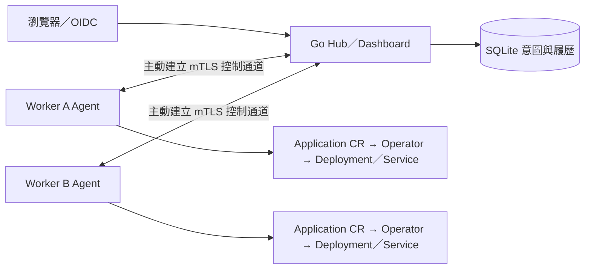

# HugoFleet

以 Go、Kubernetes Operator、SQLite 與 Go template UI 製作的應用部署平台。從 [各階段教學與程式](stages/README.md) 開始，先理解一個階段，再往下一個階段走。

提供 M0～M5 的獨立學習入口，涵蓋 HTTP API、Operator、Hub、雙叢集 Agent、租戶安全與可觀測交付。每階段包含可執行程式、操作教學與測試。

驗證方式、各階段驗收範圍與對應程式提交的 CI 證據見 [驗證總覽](docs/validation.md)。

| 想學什麼 | 文件與程式位置 |
|---|---|
| M0：HTTP API、映像、Deployment／Service | [stages/m0](stages/m0/README.md) |
| M1：Application CRD、Operator、漂移修復 | [stages/m1](stages/m1/README.md) |
| M2：Hub UI／REST、SQLite、發版與回滾 | [stages/m2](stages/m2/README.md) |
| M3：雙叢集 Agent、gRPC、mTLS、斷線重連 | [stages/m3](stages/m3/README.md) |
| M4：OIDC、租戶／配額、Security Profile | [stages/m4](stages/m4/README.md)／[分項結果](docs/m4-validation.md) |
| M5：Dashboard、OTel／metrics、Helm 交付 | [stages/m5](stages/m5/README.md)／[本機驗收結果](docs/m5-validation.md) |

每階段的 Go 程式、YAML／JSON、Dockerfile、Bash、測試與教學放在自己的資料夾。各 README 包含檔案用途、終端配置、第一次操作、預期結果、問題排查、結束與再練習方式。每個啟動入口自行準備需要的元件，叢集與執行資料分開；建議一次練習一個階段。

## 多叢集架構與示範



M3 起 Hub 不持有 Worker kubeconfig；M4 加入真實 OIDC、租戶授權與隔離，M5 加入完整 Dashboard、trace／metrics 與 Helm 交付。Worker 回報真實 Kubernetes 狀態，SQLite 保存意圖及不可變操作履歷。

[M5 示範 MP4](docs/media/m5-demo.mp4)／[播放頁](docs/media/m5-demo.html) 展示部署、故障、修復、回滾、多叢集與權限拒絕。影片是 19 張真實瀏覽器操作截圖的時間順序剪輯，並非連續錄影；等待片段省略，原始時間與 SHA-256 同附。可對照 [實際回滾 trace](docs/media/m5-rollback-trace.html)、[故障演練教學](stages/m5/README.md#故障修復與回滾) 與 [驗收及未完成項目](docs/m5-validation.md)。

## 文件怎麼讀

1. 先看本頁的環境需求，再到 [stages 索引](stages/README.md) 選階段。
2. 打開該階段的 README，依教學完成一條操作流程。命令旁會說明用途與結果；遇到問題先看該文件的診斷段落。
3. 想理解程式，從該階段的「本階段的程式導讀」往下讀，再進入元件 README：[價格 API](stages/m0/pricing-api/README.md)、[Controller](stages/m1/controller/README.md)、[Hub](stages/m2/hub/README.md)、[Agent](stages/m3/agent/README.md)、[Hub 遠端通道](stages/m3/agenttransport/README.md)。
4. 想核對 API 欄位、設計原因或驗收範圍與證據，再查 [docs](docs/README.md)。教學中的「預期」與驗收紀錄中的「實測」分開閱讀。

你可以停留在任一階段反覆練習。後面的啟動入口會準備自己需要的共用元件，不要求前面的 Demo 持續執行。資料夾依元件首次加入的階段分類；目前是一份共用 Go module，各階段使用目前版本的程式，共用同一份現行實作。

## 首次準備環境

主要執行環境為 Linux amd64。Windows 使用 Ubuntu WSL2 與 Docker Desktop Linux containers；Hub 的 SQLite 程序鎖使用 Linux flock，請在 WSL2 執行 Hub。

需要 make、Bash、curl、tar、sha256sum、sed、GNU timeout／realpath，以及可連線的 Docker。M3～M5 以非 root 的 Linux 使用者執行。Windows PowerShell 先進入 WSL：

```powershell
wsl -d Ubuntu
```

以下與各階段教學中的 Bash 命令，都在 Ubuntu WSL2／Linux 執行：

Windows checkout 位於 `C:\Users\H\Documents\GitHub\win30221\hugofleet` 時，WSL 使用以下路徑。首次操作先安裝專案工具，再檢查環境：

```bash
cd /mnt/c/Users/H/Documents/GitHub/win30221/hugofleet
make tools
make doctor
```

原生 Linux checkout 改用自己的專案路徑。WSL 無法連線 Docker 時，依 [Docker WSL integration 說明](https://docs.docker.com/desktop/features/wsl/) 啟用 Ubuntu 整合。工具安裝至專案 .tools；固定版本、SHA-256 與 image digest 以 [scripts/versions.env](scripts/versions.env)、[go.mod](go.mod)／[go.sum](go.sum) 為準。

`make tools` 下載與安裝工具；`make doctor` 檢查固定版本與 Docker，會編譯版本檢查小程式。若 kind release asset 下載逾時，可用以下既有選項從相同固定版本源碼安裝；Go 與 kubectl 仍依腳本校驗。

```bash
HF_KIND_SOURCE=1 make tools
make doctor
```

不要同時執行兩份工具安裝；等原命令結束後再重試。每個新 Bash 終端的環境設定、kubeconfig 與終端分工，請照自己階段 README 操作。

選擇階段、啟動／結束、切換與重建資料的命令集中在 [stages 索引](stages/README.md#選擇階段切換與重建)。也可進入該階段資料夾，依自己的 README 使用 bash run.sh up／down。舊 make demo／hub-up 的單叢集開發入口見 [M2 教學](stages/m2/README.md#舊單叢集開發入口)。

## 平時需要關注的東西

| 位置 | 用途 |
|---|---|
| [stages](stages/README.md) | 學習、找程式、修改範例；這是主要入口 |
| [docs](docs/README.md) | API 契約、架構決策、實測證據 |
| [HUGOFLEET_SPEC.md](HUGOFLEET_SPEC.md) | 產品需求與里程碑規格 |
| [AGENTS.md](AGENTS.md) | AI 協作規則與工作範圍 |
| [scripts](scripts/README.md)／[tools](tools/README.md)／[deploy](deploy/README.md) | 跨階段共用環境、工具與 kind 設定 |
| [Makefile](Makefile)／[PROJECT](PROJECT)／[.github](.github/workflows/ci.yml) | 命令入口、Kubebuilder metadata、CI 設定 |
| .local | kubeconfig、ownership、DB 與憑證；詳見 [stages 執行資料](stages/README.md#執行資料與原始碼的分工) |
| .tools／.cache／bin／artifacts | 已安裝工具、Go 快取、執行檔、原始驗收日誌；詳見 [共用工具說明](scripts/README.md) |

學習執行資料位於 .local/tutorials，各階段 README 說明 DB、憑證、ownership 與資料保留方式。

Hub 在 M2 使用受限 kubeconfig；M3 改由 Worker Agent 主動建立 mTLS gRPC 通道，Hub 不持有 Worker kubeconfig。M2／M3 管理介面使用本機 127.0.0.1:18090；M3 Demo Token 與憑證的操作及限制見 M3 README。

Repository 位址為 [win30221/hugofleet](https://github.com/win30221/hugofleet)，Go module 使用 github.com/win30221/hugofleet。Hosted CI 的驗收範圍與程式提交見 [驗證總覽](docs/validation.md)。

根目錄的 [go.mod](go.mod)／[go.sum](go.sum) 管理單一 module 與固定相依；不要在每階段另建 module。Makefile 是命令入口，PROJECT 保存 Kubebuilder 的 API scaffold metadata，Application 路徑指向 M1；它不是教學操作設定。

[.github/workflows/ci.yml](.github/workflows/ci.yml) 定義 hosted CI 的 Unit／Race、envtest、Helm CLI 檢查、獨立真實 Dex OIDC 負向測試與 M0～M5 六階段 kind E2E，支援 push、PR 與手動 workflow dispatch；閱讀設定可知道自動驗收範圍。本機學習用 stages 的入口，遠端 CI 是否執行與成功仍以實際結果為準。
