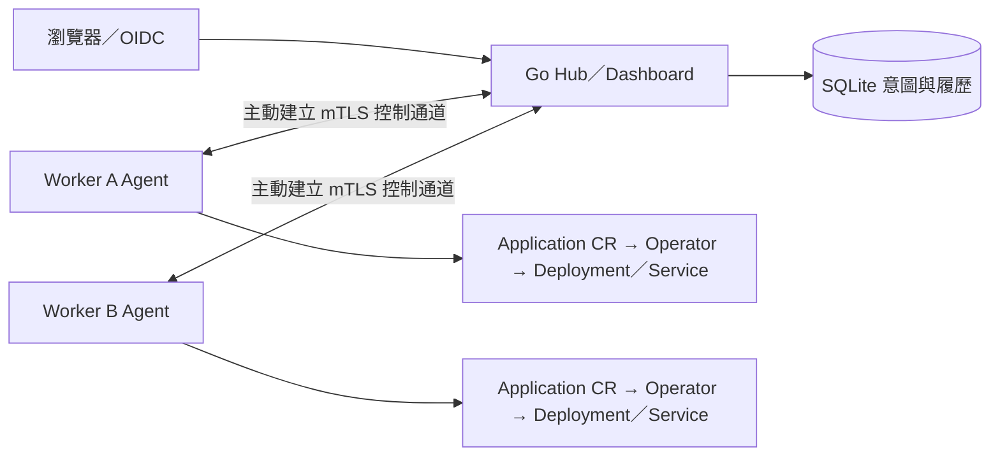

# HugoFleet

HugoFleet 是以 Go、Kubernetes Operator、SQLite 與 Go template UI 製作的應用部署平台。你可以從部署一個價格 API 開始，逐步學到自動修復、版本管理、雙叢集、租戶權限與可觀測性。

## 第一次使用：從這裡開始

你現在位於專案入口。第一次使用依這條主線前進：

**本頁環境準備 → M0 部署 API → M1 Operator → M2 Hub → M3 雙叢集 → M4 租戶權限 → M5 Dashboard 與觀測**

想先看懂流程，可開啟 [M0～M5 動畫教室](docs/animations/index.html)。下載專案後，用瀏覽器開啟 HTML，即可逐步或連續播放各章。

1. 先完成下方[首次準備環境](#首次準備環境)，直到 `make doctor` 成功。
2. 接著[開始 M0](stages/m0/README.md)，按終端分工逐步操作。
3. 每課完成後，依該課的「完成這一課後去哪裡」清理環境，再進下一課。

已經學過、要回來繼續時，使用[選課與回訪](stages/README.md#回來繼續哪一課)。API、架構與驗收文件是按需要查閱的支線，不必先讀完才能開始。

## 首次準備環境

主要環境為 Linux amd64。Windows 使用 Ubuntu WSL2 與 Docker Desktop Linux containers；Hub 的 SQLite 程序鎖使用 Linux flock，請在 WSL2 執行。

Windows 使用者先啟動 Docker Desktop，依 [Docker WSL integration 說明](https://docs.docker.com/desktop/features/wsl/) 啟用 Ubuntu 整合，再依序操作：

1. 在檔案總管開啟下載的 `hugofleet` 資料夾，確認裡面有 `Makefile`、`go.mod` 與 `stages`。
2. 在檔案總管網址列輸入 `powershell`，按 Enter。
3. 在 PowerShell 進入 Ubuntu：

```powershell
wsl -d Ubuntu
```

確認進入的是專案資料夾：

```bash
pwd
ls Makefile go.mod stages
```

路徑依下載位置而不同，應能列出上述檔案與資料夾。**後續所有 Bash 命令都從專案根目錄執行。** 需要新終端時，也從同一個資料夾開 PowerShell，再進入 WSL。原生 Linux 使用者直接在專案根目錄開啟 Bash。

需要的基礎工具為 make、Bash、curl、tar、sha256sum、sed、GNU timeout／realpath，以及可連線的 Docker。M3～M5 使用非 root 的 Linux 使用者。

首次安裝專案工具：

```bash
make tools
```

這會下載、校驗固定版本的 Linux 版 Go、kind、kubectl，安裝到專案 `.tools`，不覆寫全域工具。即使 Windows 已安裝 Go，首次使用仍需準備這些 Linux 工具；安裝完成後不用每次重跑。

接著檢查環境：

```bash
make doctor
```

預期印出 Go／kind／kubectl 版本與 Docker Linux engine 資訊，沒有錯誤。最後的 `Project cluster=hugofleet-a` 是共用命令的預設選擇，不表示叢集已建立；各階段 up 會選擇自己的環境。

如果下載 kind release asset 逾時，可在原安裝結束後改用相同固定版本的源碼安裝：

```bash
HF_KIND_SOURCE=1 make tools
make doctor
```

若 `doctor` 失敗，先讀錯誤：找不到工具就核對安裝是否完成；Docker 無法連線就回到本節確認 Docker Desktop 與 Ubuntu 整合。需要查共用設定時看[腳本說明](scripts/README.md)，處理後回本頁重跑 `make doctor`，成功才進入 M0。

不要同時執行兩份工具安裝。固定版本與校驗碼見 [scripts/versions.env](scripts/versions.env)，Go 相依見 [go.mod](go.mod)／[go.sum](go.sum)。

## 接下來做什麼

環境檢查成功後，下一站是 **[開始 M0：把價格 API 部署到 Kubernetes](stages/m0/README.md)**。本頁準備到這裡就完成；完整啟動、轉送與呼叫命令集中在 M0 教學。

M0 會帶你確認 `/version` 為 v1、價格結果為 8000 分，再練習更新與故障恢復。操作失敗時，前往 [M0 排查](stages/m0/README.md#操作遇到問題時)；完成時，依 [M0 停止與下次繼續](stages/m0/README.md#停止與下次繼續)決定保留或清理環境。

**先完成一課，再進下一課。** 不必讓之前的 Demo 持續執行。每課主線結尾都有下一課入口；想了解全部路線時再看下表。

### 學習路線

| 階段 | 你會做什麼 | 完成後應能理解 | 教學 |
|---|---|---|---|
| M0 | 部署 API、更新映像、增加副本、恢復壞版 | 映像、Pod、Deployment、Service 與探針 | [開始 M0](stages/m0/README.md) |
| M1 | 提交 Application、觀察底層漂移修復 | Operator 如何持續維持期望配置 | [開始 M1](stages/m1/README.md) |
| M2 | 從 UI 建立應用、發布、回滾與查看履歷 | Hub、SQLite、Release 與 Operation 的分工 | [開始 M2](stages/m2/README.md) |
| M3 | 部署到兩個 Worker、停止 Agent 再重連 | 主動 mTLS 通道與各叢集自主修復 | [開始 M3](stages/m3/README.md) |
| M4 | 登入、啟用租戶、授權並驗證拒絕結果 | DB 角色、配額與 Worker 安全邊界 | [開始 M4](stages/m4/README.md) |
| M5 | 用 Dashboard 操作、看 trace／metrics 與 Helm 交付 | 如何追查一次部署並理解觀測結果 | [開始 M5](stages/m5/README.md) |

## make 指令怎麼讀

`make <目標名稱>` 會讀取根目錄的 [Makefile](Makefile)，執行專案定義的操作。

| 例子 | 用途 |
|---|---|
| `make tools` | 準備專案工具；名稱有 s，沒有 `make tool` |
| `make doctor` | 檢查環境 |
| `make m0-up` | 組裝並啟動 M0 |
| `make m0-forward` | 持續轉送 M0 服務；Ctrl+C 停止連線 |
| `make m0-down` | 刪除 M0 學習叢集，保留工具與測試產物 |
| `make help` | 查看操作順序與命令用途 |

`make tools doctor` 表示依序執行兩個目標。請勿加 `-j` 並行執行有先後依賴的準備步驟。初次學習照各階段教學即可，不需要把 help 裡的命令全部跑過。

`make kind-up` 只準備指定的 kind 叢集，不等同完整啟動一課。日常學習使用明確的 `m0-up`～`m5-up`。跨階段切換、DB 與新 session 的操作見 [stages 索引](stages/README.md#選擇階段切換與重建)。

## 文件怎麼讀

| 你現在想做什麼 | 從哪裡讀 |
|---|---|
| 實際操作一課 | 上表的階段教學：命令、預期結果、排查與結束方式 |
| 找元件、切換或重建練習 | [stages 索引](stages/README.md) |
| 看程式如何處理請求 | 各課最後的程式導讀，再進入元件 README |
| 寫 API client | [docs 索引](docs/README.md) 中對應版本的 API 契約 |
| 決定跑哪些測試、核對既有結果 | [驗證總覽](docs/validation.md) |
| 理解設計取捨 | [技術文件與 ADR 導覽](docs/README.md) |
| 核對產品與里程碑要求 | [HUGOFLEET_SPEC.md](HUGOFLEET_SPEC.md) |

各階段採相同閱讀順序：目標與成果 → 前置準備 → 逐步操作 → 整課驗證與排查 → 停止與下次繼續 → 原理與進階閱讀。每一步都先確認結果，再執行下一步；自訂資料目錄在首次啟動前選定。

教學的「預期結果」供你核對操作；驗收紀錄對應明確命令、程式提交與 CI，不代表後續修改已自動通過。

## 多叢集架構與示範



M2 使用受限 kubeconfig 管理單叢集；M3 起 Hub 不持有 Worker kubeconfig。M4 加入 OIDC 與租戶安全，M5 加入 Dashboard、trace／metrics 與 Helm。Worker 回報真實狀態，SQLite 保存意圖與操作履歷。

[M0～M5 動畫教室](docs/animations/index.html) 用逐步架構分鏡說明 API 部署、Operator、發布履歷、多叢集、授權與觀測。每步依序呈現操作、系統反應與結果，支援暫停、重播與離線播放。動畫數值不是即時叢集觀測，操作指引連回完整教學；使用方式與來源見 [動畫說明](docs/animations/README.md)。

[M5 播放頁](docs/media/m5-demo.html)／[MP4](docs/media/m5-demo.mp4) 展示部署、故障、修復、回滾與多叢集操作。影片由 19 張真實瀏覽器操作截圖按順序剪輯，並非連續錄影；可對照[實際回滾 trace](docs/media/m5-rollback-trace.html) 與 [M5 驗收範圍](docs/m5-validation.md)。

## 平時需要關注的東西

| 位置 | 用途 |
|---|---|
| [stages](stages/README.md) | 各階段教學、程式、範例與測試 |
| [scripts](scripts/README.md)／[tools](tools/README.md)／[deploy](deploy/README.md) | 共用環境、工具與 kind 設定 |
| `.local` | kubeconfig、ownership、DB、帳號與憑證；不當一般快取清除 |
| `.tools`／`.cache`／`bin`／`artifacts` | 已安裝工具、Go 快取、執行檔與原始驗收日誌 |
| [go.mod](go.mod)／[go.sum](go.sum) | 單一共用 Go module 與固定相依，各階段不另建 module |
| [PROJECT](PROJECT) | Kubebuilder metadata，Application 路徑指向 M1 |
| [CI workflow](.github/workflows/ci.yml) | Unit／Race、envtest、OIDC、Helm CLI 與六階段 kind E2E |
| [AGENTS.md](AGENTS.md) | AI 開發協作規則 |

各階段使用目前版本的共用程式，不是六份歷史程式快照。Repository 為 [win30221/hugofleet](https://github.com/win30221/hugofleet)，Go module 為 `github.com/win30221/hugofleet`。Hosted CI 的對應提交與結果見[驗證總覽](docs/validation.md)。
