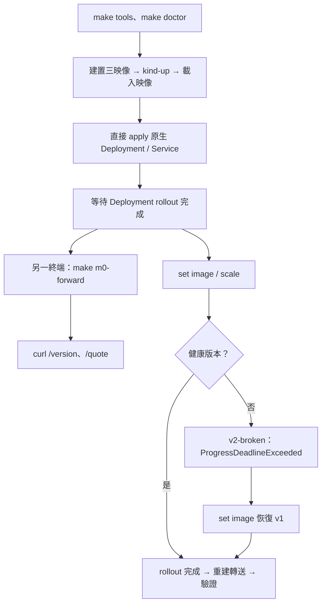

# M0 使用指南：Sample App 與單叢集基礎

本資料夾集中本階段的程式、YAML／JSON、Bash 與完整教學。找新增檔案與閱讀順序請看 [本階段的程式導讀](#本階段的程式導讀)。

本階段資源：[run.sh](run.sh)、[操作 Bash](scripts/control.sh)、[workload.yaml](workload.yaml)、[pricing-api](pricing-api/)、[驗收 Bash](scripts/e2e.sh)。在本資料夾可執行 `bash run.sh up`／`forward`／`down`；下方詳細命令以專案根目錄為起點。

M0 展示 Go pricing-api、三種真實映像、Docker／kind 與原生 Kubernetes Deployment／Service。本指南使用目前 checkout 的命令重現 M0 路徑；學到平台操作時請看 [M2 教學](../m2/README.md)／[M3 教學](../m3/README.md)。

按本指南完成原生工作負載練習，再進入 [M1 Operator 教學](../m1/README.md)。學到 Hub 時，可用 [M2 功能教學](../m2/README.md) 理解整個部署流程。

閱讀路線：[檔案地圖](#檔案地圖) → [準備與首次啟動](#1-準備環境與獨立-demo) → [呼叫](#3-轉送與呼叫) → [更新](#4-更新健康版本與縮放) → [壞版](#5-觀察壞版與手動恢復) → [結束](#6-結束再使用與切換階段) → [問題排查](#操作遇到問題時) → [程式導讀](#本階段的程式導讀)。

## 檔案地圖

| 位置 | 裡面做什麼 | 如何使用／是否手改 |
|---|---|---|
| [run.sh](run.sh) | 固定 M0 學習叢集，組合建置／部署／轉送／清理 | `bash run.sh up`／`forward`／`down`；通常不需修改 |
| [workload.yaml](workload.yaml) | Namespace、原生 Deployment／Service、資源與探針 | 本課可改的宣告範例；修改後要 apply 才影響叢集 |
| [pricing-api/main.go](pricing-api/main.go) | HTTP server、版本注入、關閉流程 | 程式入口；不是 Kubernetes 控制器 |
| [pricing-api/internal/pricing](pricing-api/internal/pricing/) | HTTP 路由與價格計算；同目錄有 Unit | 想改 API 或公式看這裡，詳細流程見 [元件導讀](pricing-api/README.md) |
| [pricing-api/Dockerfile](pricing-api/Dockerfile) | 把同一程式建成三個版本的映像 | build arg 注入版本；修改 Go 後重建映像 |
| [cmd/m0check](cmd/m0check/) | HTTP、rollout、Pod／endpoint 的 Go 驗收工具 | 正式驗收工具；不用修改來操作服務 |
| [scripts/control.sh](scripts/control.sh) | 主機 build、映像 build／load、deploy、forward、Unit／benchmark | 想知道 run.sh 每一步做什麼，對照這裡 |
| [scripts/e2e.sh](scripts/e2e.sh) | 組裝完整 M0 驗收與 owned cleanup | 使用另外的測試叢集，見第 7 節 |

本階段沿用 [scripts/common.sh](../../scripts/common.sh) 的工具與 kubeconfig 設定，以及 [kind 模板](../../deploy/README.md)。執行產物在 `.local/tutorials/m0/`，主機程式在 bin，Docker 映像在 Docker image store；它們不是本課原始碼。

## 本階段能做什麼

| 功能 | M0 的使用方式 |
|---|---|
| 價格計算 | POST /quote，以整數分計算 VIP 九折與 SAVE100 折抵 |
| 健康／就緒／版本 | GET /healthz、/readyz、/version |
| 真實映像版本 | pricing-api:v1、v2-good、v2-broken；版本由建置注入 |
| 單叢集部署 | 直接套用原生 Deployment／Service manifest |
| 更新與副本調整 | kubectl set image／scale；Kubernetes 執行 rollout |
| 故障與恢復 | 壞版 readiness 失敗；手動 set image 恢復健康版 |
| 驗收 | Go HTTP／價格測試及獨立 kind E2E |

M0 沒有 Application CRD／Operator、Hub UI／管理 API、SQLite 版本履歷、平台 revision／回滾、Agent 或租戶授權。Kubernetes 仍會維持 Deployment 指定的副本數；但沒有 M1 Operator 把手動改過的 Deployment spec 修復為 Application spec。

映像是打包好的程式；Pod 是實際執行映像的單位。Deployment 告訴 Kubernetes 要使用哪個映像、保持幾個副本；Service 提供穩定的名稱與 port。教學使用 port-forward 連到 Service 選出的 Pod，再呼叫價格 API。



## 1. 準備環境與獨立 Demo

Windows PowerShell 先進入 Ubuntu WSL2：

```powershell
wsl -d Ubuntu
```

以下在 Linux amd64／WSL2 Bash 執行，每個新終端都進入專案：

```bash
cd /mnt/c/Users/H/Documents/GitHub/win30221/hugofleet
export HF_CLUSTER=hugofleet-m0-demo
unset HF_LEARNING_ROOT
source scripts/common.sh
make tools
make doctor
```

固定版本、Docker WSL integration 與前置工具見 [README](../../README.md)。本指南使用獨立的 `hugofleet-m0-demo`。make tools 供首次安裝；已有工具時不用每開一個終端都安裝。每個新 Bash 終端只需進專案、export HF_CLUSTER、unset HF_LEARNING_ROOT、source common.sh，kubectl 才會使用本階段隔離的 kubeconfig。

### 第一次使用

終端 A 在上方環境準備後執行：

```bash
make m0-up
```

完成後命令返回，應用留在 kind 中執行。接著直接做第 3 節的轉送與呼叫，再做第 4、5 節練習。**第 2 節是 up 的展開說明與替代操作路徑，已完成 up 時不需再跑一遍。**

| 終端 | 負責什麼 | 是否保持執行 |
|---|---|---|
| A | 啟動、查看 Kubernetes、更新、恢復、清理 | up 完成後可繼續輸入命令 |
| B | port-forward | 保持前景；Ctrl+C 只停轉送 |
| C | curl 呼叫 | 每次命令完成返回；只呼叫 HTTP 不必設定 kubeconfig |

也可在本資料夾執行 `bash run.sh up`，但之後詳細練習請回專案根目錄。run.sh 只設定自己的子程序；手動 kubectl 仍需在父終端 export／source。

### 啟動到底增加了什麼

| 步驟 | 改變／產物 | 為何需要 |
|---|---|---|
| 建置 | Docker 的 pricing-api:v1／v2-good／v2-broken | 三個真實版本供更新與故障練習 |
| kind-up | hugofleet-m0-demo-control-plane；本機 kubeconfig／cluster.id | 建立單節點 Kubernetes 與明確 ownership |
| image-load | 將三個本機映像放進 kind node | Host Docker 有映像不代表 kind node 已能使用 |
| apply workload.yaml | hf-demo、pricing-api Deployment／Service | 宣告程式的執行與服務配置 |
| 等 rollout | 等目前期望的副本更新、就緒 | 建立物件成功還不等於服務可用 |

初始應有一個 pricing-api Pod，沒有 Hub、Operator 或 Agent。主機上的 bin/pricing-api 不會自動成為叢集中的版本；Pod 使用的是載入 kind 的映像。

不要對 Hub／Operator 管理中的 Deployment 執行本指南的直接變更。

## 2. 啟動原生工作負載

此節是逐步理解 up 的替代路徑；使用與第 1 節相同的 M0 環境。

終端 A 依序執行：

```bash
make demo-image-build
make kind-up
make demo-image-load
source scripts/common.sh
kubectl --context kind-hugofleet-m0-demo apply -f stages/m0/workload.yaml
kubectl --context kind-hugofleet-m0-demo -n hf-demo rollout status deployment/pricing-api --timeout=180s
kubectl --context kind-hugofleet-m0-demo -n hf-demo get deployments,services,pods
```

Manifest 建立 hf-demo namespace、pricing-api:v1 的 Deployment 及 ClusterIP Service。rollout 必須完成，Pod 應為 Ready。

| 命令 | 要看到／理解什麼 |
|---|---|
| demo-image-build | 建置三個 tag；同來源在 build 時注入不同版本 |
| kind-up | 等 node 與 CoreDNS 就緒；慢啟動日誌在 artifacts/bootstrap-hugofleet-m0-demo |
| demo-image-load | 把 host 映像載入 node；IfNotPresent 才能重用 |
| apply | 寫入工作負載 spec；不是直接啟動 Go 原始檔 |
| rollout status | 健康版最後顯示 successfully rolled out |
| get | Deployment READY 通常 1/1，Pod READY 1/1、STATUS Running |

第一次短暫 ContainerCreating／未 Ready 可等待；持續 Pending 或 ImagePullBackOff 時先看本頁診斷，不要把「物件已建立」當成成功。

**目前 `make demo-deploy` 已用於 M1 Application CR；`make demo` 用於 M2 Hub。M0 使用上方原生 manifest，不使用這兩個捷徑。**

## 3. 轉送與呼叫

終端 B：

```bash
make m0-forward
```

保持前景執行，等待 `Forwarding from 127.0.0.1:18080`。終端 C：

```bash
curl --fail http://127.0.0.1:18080/version
curl --fail http://127.0.0.1:18080/healthz
curl --fail http://127.0.0.1:18080/readyz
curl --fail http://127.0.0.1:18080/quote \
  -H 'Content-Type: application/json' \
  --data '{"amount_cents":20000,"customer_tier":"vip","coupon_code":"SAVE100"}'
```

預期版本 v1、探針 HTTP 200、價格 final_amount_cents=8000。欄位限制、取整與 HTTP 錯誤碼見 [本階段的 pricing-api 契約](#pricing-api-的-http-契約)。

價格回應應包含這組數值（JSON 空白與欄位順序不必相同）：

```json
{"original_amount_cents":20000,"tier_discount_cents":2000,"coupon_discount_cents":10000,"final_amount_cents":8000}
```

18080 是本機入口，8080 是 Pod 裡的程式 port；18090 是後面 Hub 的管理入口，M0 不會開啟它。port-forward 需要持續執行，且選中一個 Pod，不等於對外公開服務。

## 4. 更新健康版本與縮放

終端 A：

```bash
source scripts/common.sh
kubectl --context kind-hugofleet-m0-demo -n hf-demo set image deployment/pricing-api pricing-api=pricing-api:v2-good
kubectl --context kind-hugofleet-m0-demo -n hf-demo rollout status deployment/pricing-api --timeout=180s
kubectl --context kind-hugofleet-m0-demo -n hf-demo scale deployment/pricing-api --replicas=2
kubectl --context kind-hugofleet-m0-demo -n hf-demo rollout status deployment/pricing-api --timeout=180s
kubectl --context kind-hugofleet-m0-demo -n hf-demo get pods -o wide
```

應看到兩個健康新版 Pod。確認舊版 Pod 已退出後，終端 B 按 Ctrl+C、重新 `make m0-forward`，終端 C 查 `/version` 應為 v2-good；價格結果仍為 8000。

既有 port-forward 綁定一個 Pod，不會自動改接新版本；每次健康更新／恢復後重新建立連線。

## 5. 觀察壞版與手動恢復

終端 A：

```bash
kubectl --context kind-hugofleet-m0-demo -n hf-demo set image deployment/pricing-api pricing-api=pricing-api:v2-broken
if kubectl --context kind-hugofleet-m0-demo -n hf-demo rollout status deployment/pricing-api --timeout=180s; then
  printf '非預期：壞版 rollout 竟然成功，請檢查映像。\n'
else
  printf '預期的壞版 rollout 失敗；接著查看 Deployment 狀態。\n'
fi
```

**rollout 命令預期非零退出**；等到 ProgressDeadlineExceeded 或本機等待逾時，這是故障展示。使用 if 保留終端，避免 common.sh 的 errexit 設定讓 Shell 結束。請接著查看原因，不要把命令失敗當成成功更新：

```bash
kubectl --context kind-hugofleet-m0-demo -n hf-demo get deployment pricing-api -o yaml
kubectl --context kind-hugofleet-m0-demo -n hf-demo get pods -o wide
kubectl --context kind-hugofleet-m0-demo -n hf-demo get endpointslices -l kubernetes.io/service-name=pricing-api -o yaml
kubectl --context kind-hugofleet-m0-demo -n hf-demo get events --sort-by=.lastTimestamp
```

Broken Pod 為 Running，但 readiness 不通過；/healthz 為 200、/readyz 為 503，程序不因這個 readiness 故障重啟。Service 的 Ready endpoints 排除 Broken Pod；本 Demo 使用 maxSurge=1／maxUnavailable=0 且資源足夠時，上一個健康版本繼續服務。

如需直接讀 Broken Pod 的探針，在看到它 Running 後，從上方 Pod 清單取出實際名稱，在另一終端使用不同本機 port：

```bash
cd /mnt/c/Users/H/Documents/GitHub/win30221/hugofleet
export HF_CLUSTER=hugofleet-m0-demo
unset HF_LEARNING_ROOT
source scripts/common.sh
broken_pod='<實際的 Broken Pod 名稱>'
kubectl --context kind-hugofleet-m0-demo -n hf-demo port-forward \
  --address 127.0.0.1 "pod/$broken_pod" 18081:8080
```

保持這個轉送，在另一終端讀取 HTTP 狀態：

```bash
curl --include http://127.0.0.1:18081/healthz
curl --include http://127.0.0.1:18081/readyz
curl --fail http://127.0.0.1:18081/version
```

此處 curl 不使用 --fail 檢查 readiness，方便看到預期 503。觀察完在該轉送終端按 Ctrl+C。恢復版本：

```bash
kubectl --context kind-hugofleet-m0-demo -n hf-demo set image deployment/pricing-api pricing-api=pricing-api:v1
kubectl --context kind-hugofleet-m0-demo -n hf-demo rollout status deployment/pricing-api --timeout=180s
kubectl --context kind-hugofleet-m0-demo -n hf-demo get pods -o wide
```

待舊 Pod 退出，重建終端 B 的轉送，確認 /version=v1、/readyz=200、/quote=8000。這是原生 Kubernetes image 更新，不會產生 M2 Release／Operation 履歷。

若重新 apply 未修改的 workload.yaml，replicas 與 image 會回到檔案中的 1／v1。kubectl set image／scale 改的是叢集內物件，不會改本機 YAML；先分清目前想保存的是檔案配置還是一次命令練習。

## 6. 結束、再使用與切換階段

| 目的 | 操作與效果 |
|---|---|
| 停止本機連線 | 每個 port-forward 終端 Ctrl+C；應用仍在叢集執行 |
| 刪除 M0 應用 | 下方 delete manifest；會移除 manifest 中的 hf-demo namespace 及其全部資源 |
| 釋放 Demo 叢集 | 停止所有轉送，make m0-down；保留工具、主機映像與測試產物 |
| 保留叢集後再使用 | make kind-up 檢查原叢集；查看原工作負載、重新 make m0-forward |
| 轉往 M1／M2 | 先結束並清理自己的 M0 叢集，再依對應指南重新建立 |

只有此 hf-demo 確實專供本次 M0、沒有其他需要保留的資源時，才刪除 manifest：

```bash
kubectl --context kind-hugofleet-m0-demo delete -f stages/m0/workload.yaml
```

完整叢集清理：

```bash
make m0-down
```

預設 etcd 是 RAM profile；Docker node／WSL 重啟後不能假設叢集資料仍在，需檢查、限定清理並從步驟 2 重建。清理核對專案記錄的 container ID，不使用 docker system prune。

## 7. 測試與證據

以下是開發驗證選項，不是閱讀本課的必做前置；驗收範圍見階段驗收文件。

進入 M1 前，先確認自己能回答：

| 問題 | 用本階段操作核對 |
|---|---|
| 映像與 Pod 有什麼差別？ | 同一個 v1 映像可以執行兩個 Pod |
| readiness 與 liveness 為何分開？ | 壞版程序存活，但不能加入就緒服務端點 |
| 誰維持副本數？ | Deployment 控制器維持目前 spec；M0 沒有 Operator 恢復被手改的 spec |
| 服務如何證明真的能用？ | 真實 Pod 回傳 v1 與價格 8000 |

能說明這些結果後，再前往 [M1](../m1/README.md)。

只檢查 M0 Go 程式：

```bash
source scripts/common.sh
go test -count=1 ./stages/m0/pricing-api/... ./stages/m0/cmd/m0check
make benchmark
```

完整 M0 真實叢集 E2E：

```bash
make demo-image-build
make test-e2e-m0
```

E2E 使用獨立 hugofleet-m0-e2e，驗證三個映像的 HTTP、價格、rollout、Broken readiness／無 liveness restart、Ready endpoints 排除與 v1 恢復；保存 artifacts/m0-e2e/&lt;run&gt; 並清理本次叢集。現有同名叢集會讓測試停止；檢查 ownership 與診斷後才以 `HF_CLUSTER=hugofleet-m0-e2e make kind-down` 重試清理。`m0-down` 固定作用於學習叢集，不用來清理 E2E。

驗收範圍見 [M0 驗收](../../docs/m0-validation.md)。port-forward 驗證選定 Pod 的 HTTP，EndpointSlice 驗證就緒資訊，不等於驗證 kube-proxy／CNI 一般資料路徑。

## 本階段的程式導讀

M0 新增可執行的 pricing-api 與驗收工具。它直接使用 Kubernetes Deployment／Service；此入口不用 Hub、Operator 或 Agent。

| 閱讀順序 | 檔案 | 要理解的事情 |
|---|---|---|
| 1 | [pricing-api/main.go](pricing-api/main.go) | HTTP server 啟動、版本注入、關閉 |
| 2 | [pricing/http.go](pricing-api/internal/pricing/http.go) | quote／healthz／readyz／version 路由與輸入驗證 |
| 3 | [pricing/quote.go](pricing-api/internal/pricing/quote.go) | 整數價格、VIP 折扣與優惠券 |
| 4 | [Dockerfile](pricing-api/Dockerfile) | 三版映像、固定 Go builder、非 root runtime |
| 5 | [workload.yaml](workload.yaml) | 原生 Deployment、Service、readiness／liveness |
| 6 | [m0check/main.go](cmd/m0check/main.go) | 實際 HTTP、Pod／rollout／endpoints 驗收 |

`*_test.go` 與受測程式放在同一套件。完整 kind 驗收由本資料夾的 [scripts/e2e.sh](scripts/e2e.sh) 串接；教學啟動則用 [workload.yaml](workload.yaml)，可在這份教學範例做練習。

單階段開發可用 make m0-build／m0-test，benchmark 與完整驗收見第 7 節。這些與首次 up 是不同用途，驗收範圍見 [驗證總覽](../../docs/validation.md)。

後面階段沿用同一 pricing-api；M0 的工作負載由原生 manifest 建立，M1 起改由 Operator 產生。讀完後應能沿著 HTTP 請求找到價格規則，並解釋壞版為何 healthz 正常而 readyz 失敗，再往 [M1](../m1/README.md) 走。

## 操作遇到問題時

先在查詢終端設定 M0 環境，再查工作負載與事件：

```bash
cd /mnt/c/Users/H/Documents/GitHub/win30221/hugofleet
export HF_CLUSTER=hugofleet-m0-demo
unset HF_LEARNING_ROOT
source scripts/common.sh
kubectl --context kind-hugofleet-m0-demo -n hf-demo get deployments,services,pods
kubectl --context kind-hugofleet-m0-demo -n hf-demo get events --sort-by=.lastTimestamp
kubectl --context kind-hugofleet-m0-demo -n hf-demo logs deployment/pricing-api --tail=50
```

| 現象 | 原因判讀與下一步 |
|---|---|
| 18080 connection refused | 確認 B 終端顯示 Forwarding 且未結束，再確認 Service／Pod 存在 |
| bind address already in use | 停止上一課的轉送；需要第二入口時用 `HF_PORT=18082 make m0-forward`，curl 也改 port |
| ImagePullBackOff | 確認 image 拼字、先建映像再載入此叢集；不能只看 host 有映像 |
| Pending | 看 events 的排程／資源原因 |
| Running 但未 Ready | 看 image 是否 broken、探針 path／port；第 5 節這是預期 |
| 更新後仍看到舊版 | 等 rollout 與舊 Pod 退出，再重建轉送 |
| kubeconfig／ownership mismatch | 確認 HF_CLUSTER 與 source；不手改 cluster.id 接管同名容器 |
| curl 400／415／422 | 對照下方契約，JSON、Content-Type 與業務欄位是不同檢查 |

只想再連原服務時，重新 forward 即可。`make m0-up` 會再次套用初始 YAML，不能把它當成保留手動 image／replicas 的純重連命令。

程式上，一個 /quote 請求經 port-forward 進入 Pod 的 HTTP server，再由 NewHandler 選路由、驗證輸入、呼叫 Calculate、回傳 JSON。跟著 [pricing-api 深入導讀](pricing-api/README.md) 可把 HTTP 行為對到函式與測試。

## pricing-api 的 HTTP 契約

| 欄位 | 規則 |
|---|---|
| amount_cents | 必填，整數，0–1,000,000,000,000 |
| customer_tier | 必填，standard／vip，區分大小寫 |
| coupon_code | 可省略、空字串或 SAVE100 |

VIP 先以整數分計算九折並向下取整，再用 SAVE100 最多折抵 10,000 分，最低零。例如 101 分 VIP 為 90 分；100 分 VIP 加 SAVE100 為零。

POST /quote 只接受 application/json、單一 JSON 文件、最大 4 KiB。錯誤：無效 JSON／未知欄位 400、業務輸入 422、Content-Type 415、body 過大 413、method 405。回應含 X-Request-ID；錯誤含 code／message／request_id。JSON 日誌記錄請求識別、method、path、status、duration_ms，不記錄 Authorization 或 request body。

| 獨立映像 | /healthz | /readyz | /version |
|---|---|---|---|
| pricing-api:v1 | 200 | 200 | v1 |
| pricing-api:v2-good | 200 | 200 | v2-good |
| pricing-api:v2-broken | 200 | 503 | v2-broken |

版本由建置注入；沒有 runtime 開關偽裝版本。Sample 無認證，僅供本機展示。Pods 設 requests／limits、non-root、唯讀 filesystem、drop ALL capabilities、關閉 workload SA token mount；RollingUpdate 使用 maxSurge=1／maxUnavailable=0，仍需額外 Pod 資源。
