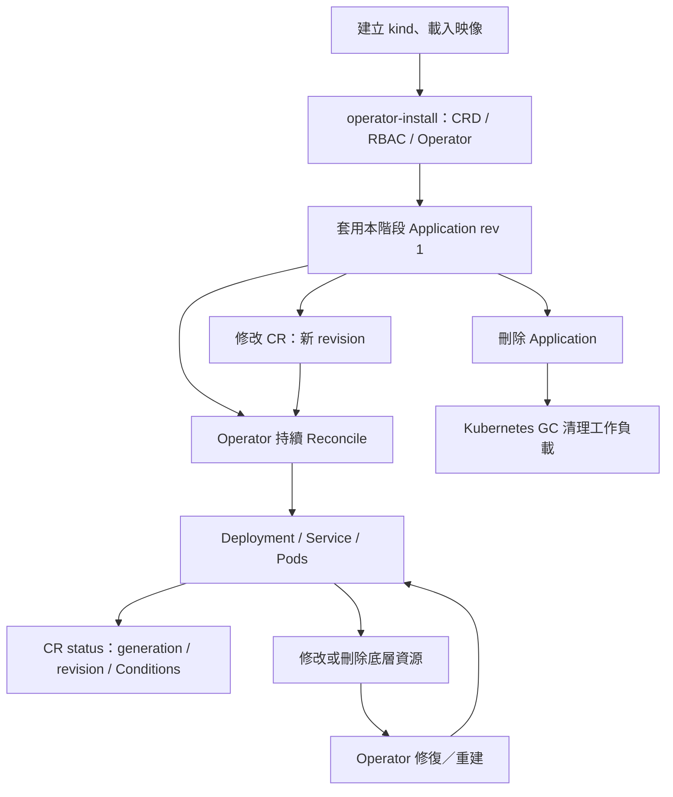
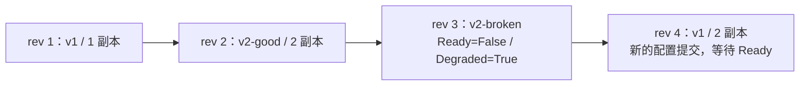

# M1 使用指南：Application CRD 與 Operator

本資料夾集中本階段的程式、YAML／JSON、Bash 與完整教學。找新增檔案與閱讀順序請看 [本階段的程式導讀](#本階段的程式導讀)。

本階段資源：[run.sh](run.sh)、[操作 Bash](scripts/control.sh)、[application.yaml](application.yaml)、[CRD／安裝 YAML](config/)、[Operator 入口](cmd/operator/main.go)、[工具 Bash](scripts/tools.sh)、[驗收 Bash](scripts/e2e.sh)。在本資料夾可執行 `bash run.sh up`／`forward`／`down`；下方詳細命令以專案根目錄為起點。

M1 在 M0 的真實工作負載上加入 Go Operator：以 Application CR 作為期望配置，持續建立、更新、修復 Deployment／Service，回報實際狀態。本指南是獨立的直接 CR 操作路徑；Hub 操作請看 [M2 教學](../m2/README.md)。

CRD 定義 Kubernetes 可以接受的 Application 型別；CR 是你建立的一個 Application 實例。spec 表達期望配置，status 記錄觀測結果。Operator 的 Reconcile 會反覆比對兩者並修復底層資源；修改 CR 與修改 Deployment 會造成不同結果。

閱讀路線：[檔案地圖](#檔案地圖) → [首次啟動](#1-準備環境與避免衝突) → [呼叫](#3-呼叫價格服務) → [更新](#4-更新為健康新版與兩個副本) → [漂移](#5-漂移修復示範) → [故障／恢復](#6-壞版與用新-revision-恢復) → [結束](#7-刪除結束與再使用) → [診斷](#操作遇到問題時)。

## 本階段能做什麼

| 功能 | M1 的使用方式 |
|---|---|
| 宣告應用 | apply Application CR，不需自行編寫 Deployment／Service |
| 更新／縮放 | 修改 CR image／replicas 與 revision，Operator 收斂工作負載 |
| 配置驗證 | CRD schema／CEL 與 Go validation 檢查 image、resources、port、replicas、probe paths |
| 狀態回報 | observedGeneration、observedRevision、Ready／Progressing／Degraded Conditions |
| 漂移修復／重建 | 底層 Deployment／Service 被修改或刪除時，Operator 自動修復／重建 |
| Ownership 保護 | 不接管外來 UID 的同名資源；保留非自身 metadata 與 Service ClusterIP |
| 工作負載清理 | 刪除 Application，由 ownerReferences／Kubernetes GC 移除相依資源 |
| 驗收 | Unit、真實 envtest、kind E2E、受限 namespace RBAC 檢查 |

M1 沒有 Hub UI、SQLite 履歷、Idempotency-Key、Operation、平台手動回滾介面、Agent 或租戶登入。恢復舊 image 要自行指定新的 CR revision；M2 才保存成功版本快照並提供回滾操作。



## 檔案地圖

| 位置 | 裡面做什麼 | 怎麼使用／修改 |
|---|---|---|
| [run.sh](run.sh)／[scripts/control.sh](scripts/control.sh) | 學習入口與展開操作 | up／forward／down；control 負責安裝與生成 |
| [application.yaml](application.yaml) | 本課提交給 Operator 的期望配置 | 可改範例；apply 才影響 CR，檔案不存執行 status |
| [api/v1alpha1](api/v1alpha1/) | Go spec／status、驗證、Scheme、DeepCopy | 改型別與 markers；DeepCopy 是工具產物 |
| [controller](controller/README.md) | Reconcile、工作負載投影與測試 | 改控制流程從這裡讀 |
| [cmd/operator/main.go](cmd/operator/main.go) | Manager、Scheme、Controller 組裝 | Operator 執行入口 |
| [config/crd/bases](config/crd/bases/) | Kubernetes 可接受的 Application schema | 由 controller-gen 產生；改 API markers 後生成 |
| [config/rbac](config/rbac/) | Operator 的 namespace Role | 由程式 RBAC markers 產生 |
| [config/operator/install.yaml](config/operator/install.yaml) | Namespace、SA／Binding、Operator Deployment | 手寫安裝模板；不是被管理的 pricing-api |
| [build/operator.Dockerfile](build/operator.Dockerfile) | Operator 映像 | 修改 Go 後重建，再載入／重啟 Operator |
| [scripts/tools.sh](scripts/tools.sh) | controller-gen、setup-envtest 等工具 | 開發 CRD／integration 時使用 |
| [scripts/e2e.sh](scripts/e2e.sh)／[test/e2e](test/e2e/) | 真實 rollout、漂移、GC、權限驗收 | 使用獨立測試環境；測試範圍見階段驗收文件 |

M1 新增的是 CRD 與 Operator；實際業務服務仍是 [M0 pricing-api](../m0/pricing-api/README.md)。共用 kind／工具從 scripts 與 deploy 取得；執行產物在 `.local/tutorials/m1/`。

## 1. 準備環境與避免衝突

使用 Linux amd64／Ubuntu WSL2＋Docker Desktop Linux containers。Windows PowerShell：

```powershell
wsl -d Ubuntu
```

在 Bash、每個新終端先進入專案：

```bash
cd /mnt/c/Users/H/Documents/GitHub/win30221/hugofleet
export HF_CLUSTER=hugofleet-m1-demo
unset HF_LEARNING_ROOT
source scripts/common.sh
make tools
make doctor
```

工具版本及 prerequisites 見 [README](../../README.md)。本指南使用獨立的 `hugofleet-m1-demo`。每個新 Bash 終端先執行上方 export／source，kubectl 會使用本階段隔離的 kubeconfig。可直接 `make m1-up` 安裝並部署；本階段 CR 放在 stages/m1/application.yaml，執行資料放在 .local/tutorials/m1。下面展開步驟，方便理解 CRD、Operator 與工作負載的關係。

M0 同名 Deployment／Service 會造成 OwnershipConflict，Operator 拒絕接管。M2 的 CR 由 Hub 管理，請回 UI／API 操作，不要用本指南改它的 spec。

### 第一次使用

make tools 供首次安裝，不用每開一個終端就重裝。終端 A 準備好上方環境後：

```bash
make m1-up
```

完成後應有一個 Operator Pod 與一個 pricing-api Pod，命令返回。直接接第 3 節呼叫，再依序做更新、漂移、故障與恢復。**第 2 節是 up 的展開與替代路徑，已完成 up 不需再跑一遍。**

| 終端 | 用途 |
|---|---|
| A | 啟動、改 CR、查 status、觀察漂移、清理；watch 時 Ctrl+C 只停觀察 |
| B | make m1-forward 保持執行；更新後停掉再重建 |
| C | curl；只呼叫 HTTP 不需要 kubeconfig |

每個新查詢終端先進專案、export HF_CLUSTER、unset HF_LEARNING_ROOT、source common.sh。run.sh 在子程序選叢集，不會設定父終端 kubeconfig。它可在本資料夾使用，後續詳細命令仍回專案根目錄。

### up 會增加什麼

| 執行順序 | 產物／責任 |
|---|---|
| 建置／載入 M0 映像 | pricing-api 三版，給 Kubernetes 執行業務服務 |
| 建置 Operator、建立 kind | hugofleet-operator:m1 與本課叢集 |
| 安裝 CRD | applications.platform.hugofleet.io，讓 API server 接受 Application |
| 安裝 Operator／RBAC | hf-demo 中的 Operator SA、Role／Binding、Deployment |
| 套用 application.yaml | pricing-api Application rev 1；Operator 才依它建立工作負載 |
| 等 observedGeneration／Ready | 確認目前 CR 已被處理並收斂，不只確認 apply 成功 |

安裝 CRD 是叢集管理者的準備工作；CRD 本身不執行 Reconcile，Operator 程式才會。

## 2. 安裝 Operator 並部署

終端 A：

```bash
make demo-image-build
make operator-image-build
make kind-up
make demo-image-load
make operator-install
kubectl --context kind-hugofleet-m1-demo apply -f stages/m1/application.yaml
generation="$(kubectl --context kind-hugofleet-m1-demo -n hf-demo get application pricing-api -o jsonpath='{.metadata.generation}')"
kubectl --context kind-hugofleet-m1-demo -n hf-demo wait \
  --for="jsonpath={.status.observedGeneration}=$generation" application/pricing-api --timeout=180s
kubectl --context kind-hugofleet-m1-demo -n hf-demo wait --for=condition=Ready application/pricing-api --timeout=180s
```

operator-install 載入 hugofleet-operator:m1，安裝 CRD、hf-demo namespace、ServiceAccount／namespace Role 與單實例 Operator，等待 Operator rollout。Application 部署步驟套用 [application.yaml](application.yaml)，等待 CR observedGeneration 對應目前 generation 及 Ready=True。

查看真實產物：

```bash
source scripts/common.sh
kubectl --context kind-hugofleet-m1-demo -n hf-demo get applications,deployments,services,pods
kubectl --context kind-hugofleet-m1-demo -n hf-demo get application pricing-api -o yaml
```

CR 預設 replicas=1、port=8080、readinessPath=/readyz、livenessPath=/healthz；revision、image、CPU／Memory requests／limits 必填。replicas 1–3，quantity 為正且 limit ≥ request，probe 只能是本機絕對 path，不含 host／query。映像格式接受小寫 repository、可選 registry port／tag／sha256 digest。

## 3. 呼叫價格服務

### 先讀懂 CR 的欄位

| 欄位 | 誰寫入 | 意義 |
|---|---|---|
| metadata.uid | Kubernetes | 此 CR 實例的身分；同名刪除重建是不同 UID |
| metadata.generation | Kubernetes | spec 變更的代數，不能用 spec.revision 推測它 |
| spec.revision | 你／後面的 Hub | 本次配置版本；本課每次意圖修改採用新 revision |
| spec.image／replicas／resources | 你 | Operator 應維持的完整配置 |
| status.observedGeneration | Operator | 最近已處理哪一代 CR |
| status.observedRevision／image | Operator | 底層 Deployment controller 已觀測到的配置，不等於 Ready |
| status.readyReplicas／availableReplicas | Operator 讀 Deployment | 現在就緒／可用的副本數 |
| conditions 的 status／reason／message／observedGeneration | Operator | Ready、Progressing、Degraded 的結果、原因與對應代數 |

更新後先比 observedGeneration 與 metadata.generation，再核對 Ready Condition 的 observedGeneration、observedRevision、image 和副本。只看到舊 Ready=True 或 observedRevision 已更新，仍不足以確認這一版成功。

終端 B：

```bash
make m1-forward
```

等待 Forwarding 訊息並保持前景執行。終端 C：

```bash
curl --fail http://127.0.0.1:18080/version
curl --fail http://127.0.0.1:18080/readyz
curl --fail http://127.0.0.1:18080/quote \
  -H 'Content-Type: application/json' \
  --data '{"amount_cents":20000,"customer_tier":"vip","coupon_code":"SAVE100"}'
```

預期 v1、HTTP 200、final_amount_cents=8000。完整價格／HTTP 契約見 [M0 pricing-api 契約](../m0/README.md#pricing-api-的-http-契約)。

## 4. 更新為健康新版與兩個副本

以下 revision 1 → 2 → 3 → 4 範例假設沒有插入其他 CR 修改。若已操作其他版本，先讀 CR、選新的 revision。先停止終端 B 的轉送，再在終端 A：

```bash
kubectl --context kind-hugofleet-m1-demo -n hf-demo patch application pricing-api --type=merge \
  -p '{"spec":{"revision":2,"image":"pricing-api:v2-good","replicas":2}}'
generation="$(kubectl --context kind-hugofleet-m1-demo -n hf-demo get application pricing-api -o jsonpath='{.metadata.generation}')"
kubectl --context kind-hugofleet-m1-demo -n hf-demo wait \
  --for="jsonpath={.status.observedGeneration}=$generation" application/pricing-api --timeout=180s
kubectl --context kind-hugofleet-m1-demo -n hf-demo wait --for=condition=Ready application/pricing-api --timeout=180s
kubectl --context kind-hugofleet-m1-demo -n hf-demo get application pricing-api -o yaml
kubectl --context kind-hugofleet-m1-demo -n hf-demo get deployment pricing-api
kubectl --context kind-hugofleet-m1-demo -n hf-demo get pods -o wide
```

generation 從 metadata.generation 取得，和自行指定的 revision 是不同欄位。需同時確認 Ready Condition 的 observedGeneration 對應目前 generation，且 CR observedRevision／image 和期望配置一致。Ready 舊值可能暫時仍為 True，不能只看到 True 就認定更新成功。

確認兩個新版 Pod Ready、舊版 Pod 已退出，重新執行終端 B 的 `make m1-forward`，在終端 C 查 /version 應為 v2-good。

## 5. 漂移修復示範

此時 Application replicas=2。手動把底層 Deployment 改為 1：

```bash
kubectl --context kind-hugofleet-m1-demo -n hf-demo patch deployment pricing-api --type=merge \
  -p '{"spec":{"replicas":1}}'
kubectl --context kind-hugofleet-m1-demo -n hf-demo get deployment pricing-api -w
```

Operator 應把 Deployment 的期望副本修復為 2。觀察後按 Ctrl+C 停止 watch；它不會停止 Operator。

改 Application spec.replicas=1，Operator 會維持 1；只改 Deployment replicas=1，而 CR 仍要 2，Operator 會修復成 2。修復不會自動新增 CR revision，也沒有 M2 SQLite Release。沿 [Controller 深入導讀](controller/README.md) 可看這次變更如何觸發 Reconcile。

需要示範 Service 重建時，在自己的 Demo 執行：

```bash
kubectl --context kind-hugofleet-m1-demo -n hf-demo delete service pricing-api
kubectl --context kind-hugofleet-m1-demo -n hf-demo get services -w
```

Operator 會重新建立 Service；按 Ctrl+C 結束 watch。新建 Service 的 UID／ClusterIP 可能不同；「保留 ClusterIP」指更新既有 Service 時，不保證刪除重建後 IP 不變。Deployment 也會在被刪除後重建，但會中斷該工作負載；日常修改請以 CR 為準。

## 6. 壞版與用新 revision 恢復

發布壞版：

```bash
kubectl --context kind-hugofleet-m1-demo -n hf-demo patch application pricing-api --type=merge \
  -p '{"spec":{"revision":3,"image":"pricing-api:v2-broken"}}'
kubectl --context kind-hugofleet-m1-demo -n hf-demo wait --for=condition=Degraded application/pricing-api --timeout=180s
kubectl --context kind-hugofleet-m1-demo -n hf-demo get application pricing-api -o yaml
kubectl --context kind-hugofleet-m1-demo -n hf-demo get deployment pricing-api -o yaml
kubectl --context kind-hugofleet-m1-demo -n hf-demo get pods -o wide
```

預期當前 generation 的 Ready=False、Degraded=True，原因包含 ProgressDeadlineExceeded；Broken Pod Running 但未 Ready。observedRevision=3 代表底層 controller 已觀測套用版本，不能當作成功。健康版仍可在資源足夠的 Demo 中提供服務。



恢復 v1，但保留 replicas=2，使用新的 revision 4：

```bash
kubectl --context kind-hugofleet-m1-demo -n hf-demo patch application pricing-api --type=merge \
  -p '{"spec":{"revision":4,"image":"pricing-api:v1","replicas":2}}'
generation="$(kubectl --context kind-hugofleet-m1-demo -n hf-demo get application pricing-api -o jsonpath='{.metadata.generation}')"
kubectl --context kind-hugofleet-m1-demo -n hf-demo wait \
  --for="jsonpath={.status.observedGeneration}=$generation" application/pricing-api --timeout=180s
kubectl --context kind-hugofleet-m1-demo -n hf-demo wait --for=condition=Ready application/pricing-api --timeout=180s
kubectl --context kind-hugofleet-m1-demo -n hf-demo get application pricing-api -o yaml
kubectl --context kind-hugofleet-m1-demo -n hf-demo get pods -o wide
```

核對目前 Condition generation、observedRevision=4、image=v1 與全部期望副本就緒。待舊 Pod 退出後重新建立轉送，驗證 /version=v1、/readyz=200、價格 8000。

M1 不儲存完整成功快照；上面的恢復是手動指定配置。目前 revision 會寫入 Pod template，即使配置相同，新 revision 也會觸發獨立 rollout；同 revision 重送仍維持冪等。這可避免把舊 ReplicaSet 的失敗誤歸給新版本，見 [ADR 0012](../../docs/adr/0012-current-revision-replicaset-evidence.md)。M2 回滾則由 Hub 複製完整歷史快照。

## 7. 刪除、結束與再使用

先在終端 B 按 Ctrl+C 停止轉送。若只結束本機連線，Operator 與應用會繼續執行。要刪除應用：

```bash
kubectl --context kind-hugofleet-m1-demo -n hf-demo delete application pricing-api
kubectl --context kind-hugofleet-m1-demo -n hf-demo wait --for=delete deployment/pricing-api --timeout=180s
kubectl --context kind-hugofleet-m1-demo -n hf-demo wait --for=delete service/pricing-api --timeout=180s
kubectl --context kind-hugofleet-m1-demo -n hf-demo get applications,deployments,services,replicasets,pods
```

刪除 CR 不等於所有 GC 即刻完成；確認 pricing-api 的 Deployment／Service／ReplicaSet／Pod 消失。hugofleet-operator 的 Deployment／Pod 繼續存在，這是正常的。

| 目的 | 操作 |
|---|---|
| 再建同名 M1 應用 | 等 GC 完成後 kubectl --context kind-hugofleet-m1-demo apply -f stages/m1/application.yaml；M1 沒有 Hub DB 名稱履歷限制 |
| 停止 Operator、保留叢集 | 下方 scale hugofleet-operator 為 0；應用繼續由 Kubernetes 執行，但沒有 Operator 修復 |
| 再啟動 Operator | scale 為 1 並等待 rollout；也可 make operator-install 重新安裝並等待就緒 |
| 保留原叢集再次使用 | make kind-up，核對應用／Operator 狀態，再 make m1-forward |
| 完全釋放 Demo | 停止所有 watch／port-forward，再 make m1-down |

停止 Operator：

```bash
kubectl --context kind-hugofleet-m1-demo -n hf-demo scale deployment/hugofleet-operator --replicas=0
```

需要恢復時執行：

```bash
kubectl --context kind-hugofleet-m1-demo -n hf-demo scale deployment/hugofleet-operator --replicas=1
kubectl --context kind-hugofleet-m1-demo -n hf-demo rollout status deployment/hugofleet-operator --timeout=180s
```

完整叢集清理：

```bash
make m1-down
```

清理只作用於核對 ownership 的專案叢集。預設 RAM etcd 不保證 Docker node／WSL 重啟後的叢集資料；需要重新檢查並清理重建。M1 單實例、不使用 leader election、沒有 HA；Operator SA 不可讀 Secrets、exec、建立 namespace 或寫其他 namespace。正式多租戶與登入留在 M4。

切換 M2 前先清理自己的 M1 叢集，再依 [M2 教學](../m2/README.md) 啟動；若已有 M2 DB 履歷，為新叢集選新 DB。

## 8. 測試與診斷

以下是開發驗證選項，不是第一次學習的前置；驗收範圍見階段驗收文件。只測 M1 可用 make m1-test，下方全專案命令範圍較大。

進入 M2 前，先完成理解檢查：

| 問題 | 用本階段操作核對 |
|---|---|
| spec 與 status 誰更新？ | 你提交 spec；Operator 回報 observedGeneration、revision 與 Conditions |
| 為何手改 Deployment 會被修復？ | Application spec 仍是 Operator 的期望配置 |
| Operator 停止後會怎樣？ | 既有服務可繼續；Application 的新配置與漂移暫時不由 Operator 收斂 |
| 刪除 CR 為何會刪除工作負載？ | ownerReferences 讓 Kubernetes GC 清理相依資源 |

能說明結果後，再前往 [M2](../m2/README.md)。

```bash
make operator-tools
make envtest
make lint build test-unit verify-generated
make test-race
make test-integration
make demo-image-build operator-image-build
make test-e2e-m1
```

上方全專案 Unit／race 使用目前 repo，包含 M0～M5 packages；m1-test 才只測 M1。envtest 使用真實 etcd／API server，驗證 schema／CEL／defaults／CRUD／ownership／metadata／ClusterIP 與 no-op；沒有 kubelet／Deployment controller／GC，不能宣稱 Pod Ready 或完整刪除成功。

kind E2E 使用獨立 hugofleet-m1-e2e，驗證更新／縮放、漂移與刪除重建、Operator 程序重啟、故障／恢復、真實 GC、價格 HTTP 與 namespace RBAC。保存 artifacts/m1-e2e/&lt;run&gt;，並清理本次叢集；同名既有叢集須先檢查，再用 `HF_CLUSTER=hugofleet-m1-e2e make kind-down` 限定清理。`m1-down` 固定作用於學習叢集。

遇到 OwnershipConflict／rollout 問題：

```bash
cd /mnt/c/Users/H/Documents/GitHub/win30221/hugofleet
export HF_CLUSTER=hugofleet-m1-demo
unset HF_LEARNING_ROOT
source scripts/common.sh
kubectl --context kind-hugofleet-m1-demo -n hf-demo get application pricing-api -o yaml
kubectl --context kind-hugofleet-m1-demo -n hf-demo get events --sort-by=.lastTimestamp
kubectl --context kind-hugofleet-m1-demo -n hf-demo logs deployment/hugofleet-operator --tail=100
```

不要刪除其他專案資源來消除 ownership 衝突。驗收範圍見 [M1 驗收](../../docs/m1-validation.md)。

## 本階段的程式導讀

M1 新增 Application API 與 Go Operator，沿用 [M0 pricing-api](../m0/README.md)。獨立入口會準備 Operator 與 Application，不用先執行 M0。

| 閱讀順序 | 檔案 | 要理解的事情 |
|---|---|---|
| 1 | [application_types.go](api/v1alpha1/application_types.go) | spec／status、revision、condition 與 CRD markers |
| 2 | [validation.go](api/v1alpha1/validation.go) | 允許的 image、資源與欄位限制 |
| 3 | [operator/main.go](cmd/operator/main.go) | 註冊 Scheme、建立 Manager、啟動 Controller |
| 4 | [application_controller.go](controller/application_controller.go) | Reconcile、ownership、狀態、更新與漂移修復 |
| 5 | [workload.go](controller/workload.go) | 從 Application 產生 Deployment／Service 配置 |
| 6 | [envtest_test.go](controller/envtest_test.go) | 真實 API server／etcd 的 schema、status 與控制器測試 |
| 7 | [m1_test.go](test/e2e/m1_test.go)、[rbac_test.go](test/e2e/rbac_test.go) | 真實 Pod、rollout、GC、最小權限驗收 |

[config/crd](config/crd/bases) 與 [config/rbac](config/rbac) 由 controller-gen 產生；[config/operator/install.yaml](config/operator/install.yaml) 是安裝設定；[build/operator.Dockerfile](build/operator.Dockerfile) 是映像。教學及驗收的範例 CR 使用本資料夾的 [application.yaml](application.yaml)。

單階段開發可用 make m1-build／m1-test，integration 與完整驗收見第 8 節。這些與首次 up 是不同用途，驗收範圍見 [驗證總覽](../../docs/validation.md)。

M2／M3 直接沿用這個 Operator 與 CRD，沒有另一套 Reconcile。API／controller 不放在 Go 的 internal 目錄，讓跨階段套件能合法共用。讀完後應能追出「改 Application → Reconcile → 工作負載 → status」，並理解為何手動改 Deployment 會被修復，再往 [M2](../m2/README.md) 走。逐函式說明、ownership 與測試邊界見 [Controller 深入導讀](controller/README.md)。

## 操作遇到問題時

在新的查詢終端：

```bash
cd /mnt/c/Users/H/Documents/GitHub/win30221/hugofleet
export HF_CLUSTER=hugofleet-m1-demo
unset HF_LEARNING_ROOT
source scripts/common.sh
kubectl --context kind-hugofleet-m1-demo -n hf-demo get application pricing-api -o yaml
kubectl --context kind-hugofleet-m1-demo -n hf-demo get deployments,services,pods
kubectl --context kind-hugofleet-m1-demo -n hf-demo get events --sort-by=.lastTimestamp
kubectl --context kind-hugofleet-m1-demo -n hf-demo logs deployment/hugofleet-operator --tail=100
```

| 現象 | 怎麼判讀與處理 |
|---|---|
| no matches for kind Application | CRD 尚未安裝／Established，或查錯叢集；先核對 context 與 operator-install |
| schema／quantity 驗證拒絕 | 查 image、replicas、resources、probe path；API server 拒絕的配置尚未進入 Reconcile |
| CR 已更新但 Deployment 未變 | 查 Operator Pod／日誌與當前 observedGeneration；確認沒有把 Operator 縮到 0 |
| OwnershipConflict | 同名資源的 controller owner UID 不匹配；不以刪除外來資源解決，回專用 M1 環境 |
| Ready 仍是 True 但 /version 是舊版 | 先核對目前 generation／revision／所有副本，再重建 port-forward |
| ProgressDeadlineExceeded | 新 Pod 無法完成 rollout；壞版練習是預期，其他情況查探針／events／資源 |
| 刪除 CR 後仍有 Pod | GC 非同步；等待被管理的 pricing-api 消失，Operator Pod 應繼續存在 |
| 修改 YAML 後沒變 | YAML 只是本機檔案，要 apply；直接 patch 不會同步改 YAML |

反覆閱讀／呼叫不用重跑 up。`make m1-up` 會重新 apply application.yaml，預設把配置帶回 rev 1／v1／1 副本；保留練習進度時只查狀態、重新 forward。M1 本身沒有 Hub／Agent 的 revision 持久去重防護，本課每次更新採用新 revision 是操作慣例，不把它說成 M3 ledger 的舊命令拒絕。

修改 CR 型別時，先改 api/v1alpha1 中的 Go／markers，再於專案根目錄用 `make generate manifests` 更新生成檔。修改 controller Go 後須重建 Operator 映像、重新安裝／重啟才會作用於 Pod；`make m1-build` 單獨產生的 bin/operator 不會自動替換叢集中的映像。驗證命令與測試範圍見 [驗證總覽](../../docs/validation.md)。
