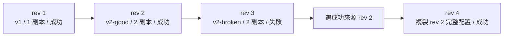
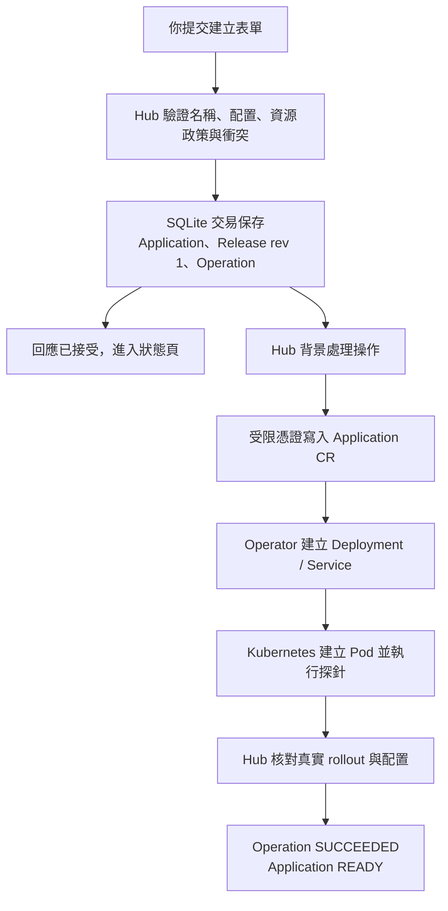
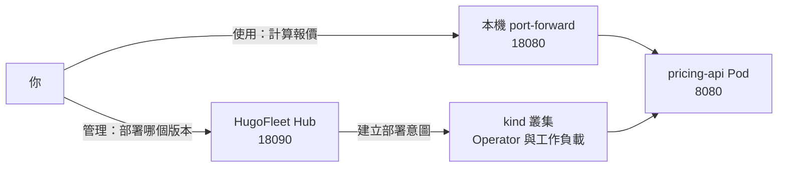
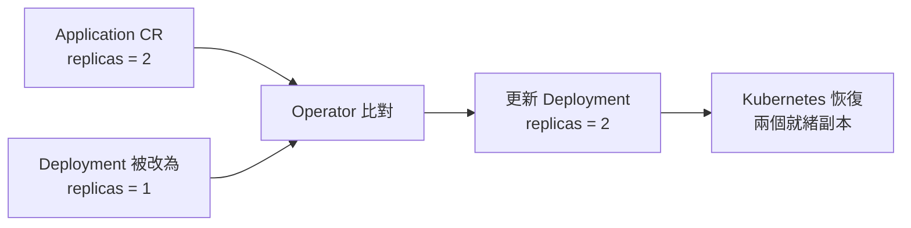

# M2：從 Hub 發布版本、保留履歷與回滾

目前位置：M2／M0～M5 學習路線 · [上一課 M1](../m1/README.md#完成這一課後去哪裡) · [選課與回訪](../README.md#回來繼續哪一課)

第一次練習從[開始前的準備](#開始前的準備)進入；上次做到一半則先看[回來繼續時先選擇](#回來繼續時先選擇)。

## 這一課的目標與成果

這一課會帶你從瀏覽器建立價格 API，發布健康新版、觀察壞版失敗，再用成功快照回滾。M1 的 Operator 繼續維持工作負載，Hub 新增 UI／REST、SQLite 與每次部署的履歷。

第一次操作以 UI 為主。先完成下方準備，再依下方主線操作；名詞、檔案地圖、REST 替代方式與程式導讀放在後面查閱。

完成後，你會看到 v1 → v2-good → 壞版失敗 → 新 revision 回滾的履歷，且服務回傳 8000 分。此課限單叢集開發模式。

依序閱讀：[開始前的準備](#開始前的準備) → [逐步操作](#逐步操作) → [整課驗證與常見問題](#整課驗證與常見問題) → [停止與下次繼續](#停止與下次繼續)。完成後再查[原理與進階閱讀](#原理與進階閱讀)。

## 開始前的準備

### 開始前：位置、工具與上一階段

Windows 從專案資料夾開 PowerShell，執行 `wsl -d Ubuntu`；後續 Bash 命令都在專案根目錄執行，詳細步驟見[根 README](../../README.md#首次準備環境)。已在 M0／M1 安裝工具就不用重裝，尚未安裝才執行 `make tools`。

上一課若仍在執行，先停轉送／watch，再用原階段的 down 清理，例如 `make m1-down`。M2 啟動會自行準備價格 API、Operator 與受限 Hub 憑證，不需要先啟動 M0／M1。

| 操作順序 | 在哪裡 | 看到什麼才繼續 |
|---|---|---|
| 啟動 M2 | 終端 A | Hub 持續執行，18090 可開啟 |
| 建立 pricing-api | 瀏覽器 | Operation SUCCEEDED、Application READY |
| 轉送並呼叫 | 終端 B／C | v1、價格 8000 分 |
| 發布 v2-good／兩副本 | 瀏覽器 | 新操作成功、兩個副本就緒 |
| 發布 v2-broken | 瀏覽器 | FAILED／TIMED_OUT，保留原因 |
| 回滾成功快照 | 瀏覽器 | 新 revision 成功、服務恢復 |
| 結束 | 終端 A／B | Ctrl+C 停 Hub／轉送，再 make m2-down |

`18090` 是管理頁面，`18080` 是轉送後的價格 API。打開管理頁不會自動建立應用。此課是本機開發模式，不需要登入；後面的 M4 才加入 OIDC 與租戶角色。

## 逐步操作

依下列順序切換終端與瀏覽器。每一步先核對預期結果再繼續；命令失敗時，先看[常見問題](#操作遇到問題時)，不要接著執行後續變更。

### 1. 建立應用與呼叫 API

**用途：**將某個映像變成叢集中實際執行、能接受 HTTP 呼叫的服務。

終端 A 執行以下命令。這是第一次使用預設 M2 環境的設定；若要接續自訂 DB，保留原 HF_HUB_DATABASE，不執行清除它的 unset。

```bash
export HF_CLUSTER=hugofleet-m2-demo
unset HF_LEARNING_ROOT HF_HUB_DATABASE HF_HUB_KUBECONFIG HF_HUB_POLICY
source scripts/common.sh
make doctor
make m2-up
```

#### 瀏覽器：建立第一個應用

當 Hub 開始持續輸出日誌時，保留終端 A。開啟 [Hub UI](http://127.0.0.1:18090)，以名稱 pricing-api、image pricing-api:v1、replicas=1、port=8080 建立應用；其餘使用預設。

`make m2-up` 最後執行前景 Hub，停在日誌持續輸出是正常行為；Ctrl+C 才會停止管理程序。

| 終端 | 用途 | 環境 |
|---|---|---|
| A | Hub 啟動與日誌 | 保持前景執行 |
| B | make m2-forward | 回專案根目錄，保持轉送 |
| C | curl 或 kubectl | HTTP 只需 URL；kubectl 要 export HF_CLUSTER、source common.sh |
| 瀏覽器 | 管理 UI | 使用精確的 127.0.0.1:18090；M2 不用登入 |

up 自行準備依賴，不需要先開 M0／M1 Demo。完成後應有 Operator，還沒有 pricing-api；由你提交建立請求後才有業務工作負載。

| up 內部步驟 | 產物 |
|---|---|
| 建置 M0／M1 映像、建立／載入 kind | 本課單叢集與共用元件 |
| 安裝 CRD／Operator | Application API 與持續 Reconcile |
| Hub bootstrap | hf-demo 受限憑證寫到 `.local/tutorials/m2/hub/kubeconfig` |
| 啟動 Hub | 編譯 bin/hub、開 DB、載入 policy、HTTP 與 Runner |
| 建立應用 | SQLite Application／rev 1／Operation，之後真正寫 CR |

可以直接進本資料夾 `bash run.sh up`；其餘詳細命令以專案根目錄為起點。run.sh 設定的 DB／kubeconfig 是子程序環境，後續自己開 Hub 要明確給相同路徑，見第 7 節。

等待 SUCCEEDED／READY，才能說這次部署已經確認成功。REST 回應 202 或畫面跳到詳細頁，代表請求已接受，還沒有等到完整部署。

#### 終端 B：轉送服務

等應用 SUCCEEDED／READY 後執行：

```bash
make m2-forward
```

等待顯示 `Forwarding from 127.0.0.1:18080`，保持終端 B 執行。轉送將 API 暫時接到本機，不會建立 Ingress。

#### 終端 C：確認服務能用

```bash
curl --fail http://127.0.0.1:18080/version
curl --fail http://127.0.0.1:18080/quote \
  -H 'Content-Type: application/json' \
  --data '{"amount_cents":20000,"customer_tier":"vip","coupon_code":"SAVE100"}'
```

預期版本是 v1，final_amount_cents 是 8000。計算使用整數分：20,000 分 → VIP 九折得到 18,000 分 → 折抵 10,000 分 → 最後 8,000 分。這個業務結果是用來確認真正的服務正在執行；HugoFleet 的管理邏輯是部署與版本管理，價格公式則在 pricing-api。

**理解檢查：**18090 能打開但 18080 連不上，先檢查應用是否 READY，以及終端 B 的 port-forward 是否仍在執行。

**下一步：**確認本步結果後，前往[2. 發布健康版本與增加副本](#2-發布健康版本與增加副本)。 若未符合預期，先到[操作排查](#操作遇到問題時)，處理後回到本步重試。

### 2. 發布健康版本與增加副本

**用途：**選擇程式版本與執行配置，並用更多副本提供服務。副本增加不等於自動擴縮，也不保證效能按倍數提升。

| 欄位 | 影響什麼 | 目前範例 |
|---|---|---|
| Image | 執行哪個建置出的程式 | pricing-api:v1／v2-good／v2-broken |
| Replicas | 期望多少個服務 Pod | 1–3；沒有縮到 0 的停止功能 |
| Port | Deployment／Service 與探針使用的服務 port | pricing-api 映像實際監聽 8080，教學保持 8080 |
| CPU／Memory requests | 配置 Pod 的資源需求，用於排程；Hub 也用它預檢 surge 預算 | 100m CPU、64Mi Memory |
| CPU／Memory limits | 配置每個 Pod 的資源上限 | 300m CPU、128Mi Memory |
| Readiness path | 判斷此 Pod 是否準備好接受流量 | /readyz |
| Liveness path | 判斷此程序是否仍健康 | /healthz |

100m CPU 表示 0.1 個 CPU，300m 為 0.3 個 CPU；表單的資源值是每個 Pod 的配置，不是整個叢集的 RAM。修改 port 不會改寫映像內程式的監聽設定，必須與程式本身一致。

在應用詳細頁「發布新版本」，把 Image 改為 pricing-api:v2-good、Replicas 改為 2，其他配置保持不變，按「建立新的 revision」。這一次接受的完整配置會成為 Release revision 2。

等待 Operation SUCCEEDED、Application READY。終端 C 先載入 M2 查詢環境，再核對兩個副本：

```bash
export HF_CLUSTER=hugofleet-m2-demo
unset HF_LEARNING_ROOT
source scripts/common.sh
kubectl --context kind-hugofleet-m2-demo -n hf-demo get deployment pricing-api
kubectl --context kind-hugofleet-m2-demo -n hf-demo get pods -o wide
```

應有兩個新版的就緒副本。確認舊版 Pod 已退出，在終端 B 按 Ctrl+C、重新 make m2-forward，再於終端 C 呼叫 /version，應為 v2-good。

此處 port-forward 選定一個 Pod，不會把多次 curl 平均分給兩個副本，也沒有經過 Service 的一般資料路徑。兩個副本是否都就緒要查看 Kubernetes 狀態，不能只靠一次 HTTP 成功判斷。

本教學的 v2-good 保留相同價格規則，它用來展示健康版本更新。v2-broken 則特意令 readiness 失敗。三個版本都是真實獨立映像。

**映像版本與 revision 的差別：**v2-good 是程式建置版本；revision 2 是平台接受的第 2 次部署配置。只調 replicas 也會增加 revision；同一映像可以用在不同 revision。直接 Kubernetes CR 的 metadata.generation 又是另一個欄位，用來確認 controller 是否觀測到目前資源變更，詳見 [M1 操作](../m1/README.md)。

REST 發版使用完整配置加 defaults，未填欄位不自動沿用上一版；UI 則會先預填最新快照，供你確認與修改。

**下一步：**確認本步結果後，前往[3. 理解 Operator 的漂移修復](#3-理解-operator-的漂移修復)。 若未符合預期，先到[操作排查](#操作遇到問題時)，處理後回到本步重試。

### 3. 理解 Operator 的漂移修復

**用途：**讓底層工作負載持續符合 Application CR 的期望配置，不必每次人工重新部署。

Reconcile 的意思是反覆比對「應該是什麼」與「現在是什麼」，有差異就嘗試修復。例如 CR 要求兩個副本，但 Deployment 被人改成一個，Operator 會恢復 Deployment spec 的 replicas=2。

完整元件分工與限制見[Operator 的修復邊界](#operator-的修復邊界)。

想動手練習底層 replicas 漂移，使用 [M1 使用指南的獨立 Demo](../m1/README.md#9-終端-a觀察漂移修復)。不要為了此練習把目前 Hub 的 Application CR 改成別的 revision。

**理解檢查：**Hub 關閉、Operator 仍在同一叢集執行時，已有的應用仍會被修復；但不能從已關閉的 Hub UI 發起新部署。

**下一步：**確認本步結果後，前往[4. 部署故障版本並觀察結果](#4-部署故障版本並觀察結果)。 若未符合預期，先到[操作排查](#操作遇到問題時)，處理後回到本步重試。

### 4. 部署故障版本並觀察結果

**用途：**分辨「程序正在執行」與「新版本確實可以提供服務」，避免看到 Pod 存在就說部署成功。

| 訊號 | 回答的問題 | v2-broken 的結果 |
|---|---|---|
| /healthz：liveness | 程序是否健康到可以繼續執行？ | 200；不以此故障觸發 liveness restart |
| /readyz：readiness | 這個 Pod 是否準備好接受服務流量？ | 永遠 503；不成為 Ready endpoint |
| rollout 完成 | 目標配置是否已被觀測，而且全部期望副本都更新、就緒與可用？ | 無法完成，最終報錯或逾時 |

從本課第 2 步成功的 revision 2 發布 pricing-api:v2-broken，保留 replicas=2 與其他配置。這次會建立 revision 3。

在詳細頁觀察新操作從進行中變成 FAILED／TIMED_OUT，以及錯誤與事件。常見原因是 ProgressDeadlineExceeded。目前可用性可顯示 DEGRADED，即使上一版仍能回應部分或全部流量，失敗的新 Release 仍應是 FAILED。

本 Demo 的 RollingUpdate 使用 maxSurge=1／maxUnavailable=0，允許更新期間多一個 Pod，以便新 Pod 就緒後再替換舊 Pod。replicas=2 時須為最多 3 個 Pod 的更新預算保留資源；這就是 Hub 預檢 replicas+1 的原因。資源不足也可能造成 rollout 失敗，不能把這種保護理解為不會停機的保證。

Hub 預設 deadline 是 180 秒；TIMED_OUT 表示這次管理操作超過等待期限，Kubernetes 之後仍可能繼續 rollout。

**理解檢查：**壞版 Pod 是 Running、/healthz 是 200，卻無法部署成功，因為 readiness 與完整 rollout 還沒有達成。

**下一步：**確認本步結果後，前往[5. 看懂狀態並回滾成功快照](#5-看懂狀態並回滾成功快照)。 若未符合預期，先到[操作排查](#操作遇到問題時)，處理後回到本步重試。

### 5. 看懂狀態並回滾成功快照

**用途：**保留每次配置與結果，失敗時知道恢復哪個版本，也避免把歷史失敗悄悄改成成功。

同一個詳細頁呈現三類資訊：

| 資訊 | 你會用它回答什麼 |
|---|---|
| Release 履歷 | 那次部署的完整 image／replicas／resources／probes 是什麼？哪一版曾成功？ |
| Operation 履歷 | 那次建立、發版、回滾或刪除何時開始？最後成功、失敗或逾時？ |
| 目前觀測／事件 | 現在叢集的可用性與錯誤是什麼？何時觀測？故障是否恢復？ |

完成前三次部署後，在「手動回滾」選 revision 2，勾選確認並提交。Hub 會複製 revision 2 的完整快照，建立 revision 4；恢復到 v2-good 與兩個副本。



回滾完成後重建 port-forward，確認 /version 是 v2-good、/readyz 是 200，價格仍為 8000。下面是這條固定教學主線各步驟結束後的版本欄位，假設 CR 寫入已確認：

| 教學步驟 | desired_revision：最後接受 | applied_revision：CR 已寫入 | last_successful_revision：最後成功 |
|---|---|---|---|
| v1 成功 | 1 | 1 | 1 |
| v2-good／兩個副本成功 | 2 | 2 | 2 |
| v2-broken 失敗 | 3 | 3 | 2 |
| 以 revision 2 回滾成功 | 4 | 4 | 4 |

如果自行增加其他更新，revision 會不同，請依畫面選實際成功來源。回滾後 4 表示最新成功的是新的回滾操作，不表示映像一定叫 v4。

在失敗／逾時之後才觀測到 READY 時，事件可記錄 LATE_READY，目前 Application 也可能是 READY；原 Operation 的 TIMED_OUT／FAILED、Release 的 FAILED 與最後成功版本不被改寫。若要正式確認這份配置，需提交新的發版或回滾。

目前故障欄位 observation_error_code／message 與 Operation 的歷史錯誤分開。例如曾失敗的操作仍會留下原因，但目前故障可能已清除。UNKNOWN 則表示無法確認最新叢集結果，應配合最近觀測時間閱讀。

**理解檢查：**回滾是「以舊快照建立新的部署」，會保留失敗版與原成功版履歷；它不是刪除故障紀錄，也不是只把 image 字串改回去。

**下一步：**前往[整課驗證](#整課驗證與常見問題)，核對這一輪的結果。 若未符合預期，先到[操作排查](#操作遇到問題時)，處理後回到本步重試。

## 整課驗證與常見問題

完成主線後，核對以下結果；若有一項未達成，先排查再繼續。

- 初版與健康版的 Operation 都成功，服務價格為 8000。
- 故障版留下 FAILED／TIMED_OUT 與原因。
- 回滾建立新的成功 revision，服務恢復 v2-good／兩副本，故障履歷保留。

這些是本輪操作的檢查點，不是新的驗收證據。自動化測試與既有結果見 [M2 驗收](../../docs/m2-validation.md)。


**核對完成後：**若已達成本課成果，前往[停止與下次繼續](#停止與下次繼續)。想繼續進階實作時先保留環境，從[原理與進階閱讀](#原理與進階閱讀)選擇練習；純閱讀不需保持服務運作。尚有問題則先用下方排查，修正後回到失敗步驟。
### 完成教學後的自我檢查

| 能回答的問題 | 對應功能 |
|---|---|
| 為什麼部署接受後還要等 SUCCEEDED／READY？ | 非同步 Operation 與真實 rollout 驗證 |
| 把 replicas 從 1 改為 2，誰建立新的 Pod？ | Hub → CR → Operator → Kubernetes 的分工 |
| 為什麼壞版程序還活著卻不能部署成功？ | liveness／readiness／rollout |
| image 叫 v1，為什麼 revision 可以是 4？ | 程式版本與部署快照版本分開 |
| 回滾為什麼要新增版本？ | 保存完整履歷與新的操作結果 |
| 409 要怎麼處理？ | 去重、基準 revision 與單一活動操作 |
| 關閉 Hub 後應用是否還會執行？ | 控制面與工作負載生命週期 |
| 後面階段增加哪些能力？ | M3 多叢集、M4 登入／租戶隔離、M5 Dashboard／可觀測性與 Helm；依各階段指南操作 |

本教學的預期結果供操作時核對。測試範圍與證據見 [M2 驗收](../../docs/m2-validation.md) 與 [驗證總覽](../../docs/validation.md)。

### 6. 遇到 409 時怎麼處理

**用途：**避免網路重送造成重複部署，或兩個人／兩個分頁同時提交而互相覆蓋。

| 保護 | 日常情境 | 平台如何處理 |
|---|---|---|
| Idempotency-Key：請求去重 | API 提交後沒收到回應，想重送同一次請求 | 同 key、同動作與同解碼 payload 回同一 Operation，不新增 Release |
| key 與內容一致性 | 把同一 key 改成另一個 image 重送 | 409；新意圖要用新的 key |
| expected_desired_revision：確認提交基準 | 舊分頁停留在 revision 2，但其他分頁已提交 revision 3 | 409；先讀回目前版本，再決定新配置 |
| 同應用單一活動操作 | 前一個 rollout 還在進行，立刻又發版／刪除 | 409；等操作結束後再提交 |
| 資源政策 | 設定的每 Pod limits 或含 surge 的 requests 超過本機政策 | 拒絕不合政策的配置；真正叢集 quota 拒絕則由 Kubernetes 回報 |

UI 自帶表單的去重 key 與基準 revision；API 使用者要自己帶這些欄位。不同 key 的相同內容屬於新請求，仍會檢查 revision 與活動操作。

遇到 409，先看是否還有 RUNNING 操作、重新整理目前 revision；不要任意換 key 重送過期配置。REST 的完整範例見 [M2 API 說明](../../docs/m2-api.md)。

M2 的資源限制是單應用配置預檢，沒有跨應用資源總量排程或真正的團隊配額。改大數字不能確保叢集有足夠實際資源。

若叢集 quota 曾造成 FailedCreate，解除限制後先等實際 Pod／rollout 恢復，再提交新發版確認成功。目前每個新 revision 都更新 Pod template 的 revision marker，包含相同配置與純縮放，因此觸發獨立 rollout／ReplicaSet；相同 revision 重送才維持冪等。這也需要計入 rollout surge 的 quota。見 [ADR 0012](../../docs/adr/0012-current-revision-replicaset-evidence.md)。原 FAILED Operation／Release 履歷仍保留，晚到 Ready 不會自動改成成功。

### 操作遇到問題時

依「管理 HTTP → SQLite 操作 → CR → Deployment／Pod」的順序查，先找流程停在哪層。在新查詢終端：

```bash
export HF_CLUSTER=hugofleet-m2-demo
unset HF_LEARNING_ROOT
source scripts/common.sh
kubectl --context kind-hugofleet-m2-demo -n hf-demo get applications,deployments,services,pods
kubectl --context kind-hugofleet-m2-demo -n hf-demo get application pricing-api -o yaml
kubectl --context kind-hugofleet-m2-demo -n hf-demo get events --sort-by=.lastTimestamp
kubectl --context kind-hugofleet-m2-demo -n hf-demo logs deployment/hugofleet-operator --tail=100
```

Application 不存在時，先看 UI Operation 是否還 QUEUED／DISPATCHED、Hub 的錯誤與 Cluster CONNECTED；Application 存在但工作負載失敗，讀 CR conditions、Pod events 與 Operator 日誌。Hub 日誌在前景終端 A，不是另一個 M2 Hub Pod。

| 狀況 | 先看什麼 |
|---|---|
| Hub 403／Host 錯誤 | 使用精確的 127.0.0.1:18090，表單從同一 UI 送出 |
| 叢集離線／受限憑證過期 | 檢查 kind／Operator；停止 Hub，重新 make m2-up 產生受限憑證並啟動 |
| 應用名稱衝突 | 檢查 SQLite 歷史與同名 CR；已刪除名稱換新名稱，外來 CR 不接管 |
| 409 衝突 | 等目前操作結束，再查最新 desired revision；相同 key 不改 payload |
| 更新後看到舊映像 | 等 rollout／舊 Pod 退出，再重建 port-forward |
| kind 啟動失敗 | 查看 artifacts/bootstrap-<cluster>；依 ownership 記錄限定清理 |
| SQLite locked／another Hub | 同一份 DB 只啟動一個 Hub；先停止原程序，不刪鎖檔或 live DB |
| DB 模式不匹配 | M2／M3 不共用同一 DB；選自己的教學 DB，不手動改 registry |
| curl 回 202 卻連不到服務 | 先查 Operation 終態與 Application READY，再啟動正確 Service 的轉送 |
| UI 更新後仍是舊內容 | 重新整理以讀目前 revision；修改 template 要重建／重啟 Hub |

目前最多 30 個未刪除應用；UI 列表每頁 50 個，詳細頁各顯示最近 50 筆履歷；API 詳細頁最多 100 筆。舊歷史留在 DB，尚無歷史搜尋／匯出。操作中 UI 每 3 秒重新整理；完成後以「重新整理狀態」查目前觀測。

## 停止與下次繼續

### 回來繼續時先選擇

先依原環境的情況選一條路；下方停止與重建命令不是需要依序全部執行的清單。

| 目前情況 | 下一步 |
|---|---|
| 原 Worker 正常，只停了轉送／Hub | 依下方說明使用相同 DB 與受限憑證恢復 Hub，再建立轉送，回[逐步操作](#逐步操作)接續。 |
| 已 down、Worker 重建或憑證失效 | 依下方重建說明先處理原環境，再選新 DB開始新一輪；保留舊資料不等於能恢復舊 Worker。 |
| 不確定上次停在哪裡 | 沿用原 DB 與環境，先看[操作排查](#操作遇到問題時)，不要直接換資料目錄。 |

### 7. 停止、恢復與結束練習

**用途：**停止管理程序時保存資料，恢復後能讀回配置與處理記錄，並清楚區分停止連線與刪除應用。

SQLite 保存 Application、完整 Release 快照、Operation、去重資料與事件；Kubernetes 保存當地 CR 與真實工作負載。DB 中的成功歷史不會取代目前叢集觀測。

Hub 正常關閉或程序崩潰後，在同一個仍有效的叢集與同一 DB 上重新啟動，會讀回履歷、核對待處理操作，保留原 command_id 與 deadline；已過 deadline 的操作不會因重啟獲得新的等待時間。此處不用刻意 SIGKILL 練習，正常停止／重啟即可觀察履歷，故障恢復的實測見 [M2 驗收紀錄](../../docs/m2-validation.md)。

| 你想達成什麼 | 做法 | 結果 |
|---|---|---|
| 暫時不看 UI | 關閉瀏覽器 | Hub、Operator、應用繼續執行 |
| 不再從本機呼叫服務 | 終端 B Ctrl+C | 停止 port-forward，Pod 不刪除 |
| 暫停管理平台 | 終端 A Ctrl+C | Hub 停止，DB 留存；Operator 與既有應用繼續 |
| 移除應用 | Hub 執行時，由 UI 確認刪除並等到 DELETED | Kubernetes 工作負載清除，部署履歷保留 |
| 釋放整個 Demo | 停止 Hub／轉送，再 make m2-down | 刪除專案叢集；DB、工具與主機映像仍保留 |

保留原叢集後再次啟動，在專案目錄執行：

```bash
make m2-up
```

這個入口會重新準備／安裝共用元件與產生受限憑證，然後啟動同一 DB；它不會重新 apply M1 的初始 application.yaml。若只想重啟 Hub，且原 kind／Operator 與受限憑證仍有效，可用下面較小的步驟，避免再次建置所有映像：

```bash
export HF_CLUSTER=hugofleet-m2-demo
unset HF_LEARNING_ROOT
source scripts/common.sh
export HF_HUB_KUBECONFIG="$PWD/.local/tutorials/m2/hub/kubeconfig"
export HF_HUB_DATABASE="$PWD/.local/tutorials/m2/hub/hub.db"
export HF_HUB_POLICY="$PWD/stages/m2/policy.json"
bash stages/m2/scripts/control.sh hub-up
```

若使用自訂 DB，上方 HF_HUB_DATABASE 改成那一份實際路徑。憑證需要重發時，在相同環境先 `bash stages/m2/scripts/control.sh bootstrap`，再 hub-up。啟動前須明確設定 HF_HUB_KUBECONFIG 與 HF_HUB_DATABASE；缺少設定時，內部啟動命令會拒絕執行。

自訂 DB 時每次沿用相同 HF_HUB_DATABASE。bootstrap 產生短期 namespace 憑證，預期約 8 小時，需重新 bootstrap 並重啟 Hub 才讀取新檔案。

完整結束本課：在 A、B 分別 Ctrl+C 停 Hub 與轉送，再在專案根目錄 `make m2-down`。之後想從頭重建，要選新 DB：

```bash
export HF_HUB_DATABASE="$PWD/.local/tutorials/m2/hub/m2-session-02.db"
make m2-up
```

同輪反覆練習可由 UI 發新 revision，不需每次 down。刪除後名稱仍留在 DB 歷史，不能再用同名 create；想再建立可用新名稱，但 m2-forward 固定找 service/pricing-api，此時改用自己的 service 名稱：

```bash
export HF_CLUSTER=hugofleet-m2-demo
unset HF_LEARNING_ROOT
source scripts/common.sh
kubectl --context kind-hugofleet-m2-demo -n hf-demo port-forward \
  --address 127.0.0.1 service/pricing-api-02 18080:8080
```

這個例子假設你已由 UI 建立 pricing-api-02 並等到成功；不要先貼轉送命令再期待它建立服務。

預設 etcd 是 RAM profile，Docker node 停止／重啟後不能假設叢集資料還在；保留 Hub DB 也不會自動重建原叢集。重建叢集後應使用新的 DB，避免舊 UID 綁定。現有驗收不代表主機斷電、WSL／Docker node 重啟或備份還原已驗證。

**理解檢查：**關閉 Hub 不會釋放全部叢集資源；刪除應用不會清掉 SQLite 歷史。詳見 [本教學的結束流程](#7-停止恢復與結束練習)。

### 完成這一課後去哪裡

- **進入下一課：**先停止本課的 watch／轉送與前景 Hub，以原階段的環境執行 `make m2-down`；完成後前往 [M3：雙叢集 Agent](../m3/README.md#開始前的準備)。
- **下次繼續／重新練習：**回到[本輪環境選擇](#回來繼續時先選擇)，依原叢集與資料是否仍有效決定恢復方式。
- **深入本課：**閱讀[原理與進階閱讀](#原理與進階閱讀)。要做需要叢集的進階演練，先保留本輪環境；完整 down 後須依重建流程重新準備。

## 原理與進階閱讀

以下依需要查閱；進階演練若需要仍在執行的環境，請在完整 down 前操作。開發測試入口不屬於首次教學的必做步驟。

### M0、M1、M2 的分工

三個階段逐步減少手動維護，並加入部署管理規則。目前 M2 使用的是 M0 的服務與 M1 的 Operator，不需要先各跑一遍早期 Demo。

| 階段 | 解決的問題 | 新增能力 | 你主要操作什麼 |
|---|---|---|---|
| M0 | 程式能否在真實叢集執行？ | 價格 API、三個映像、Deployment／Service、探針與 HTTP 驗證 | 原生 Kubernetes 工作負載 |
| M1 | 配置被改動後，誰持續維持應用的期望狀態？ | Application CRD、Operator、狀態與漂移修復 | Application CR |
| M2 | 怎麼保存每次部署、拒絕衝突、回滾與恢復待處理操作？ | Hub、UI／REST、SQLite、Release／Operation／事件 | Hub 表單或 API |

後續階段的動機也不同；獨立操作與實際完成程度見 [M3 指南](../m3/README.md)、[M4 指南](../m4/README.md) 與 [M5 指南](../m5/README.md)：

| 階段 | 要補的能力 | 為什麼需要 |
|---|---|---|
| M3 | 多叢集、Agent 主動連 Hub、gRPC／mTLS、重連同步 | 管理不同 Worker，且 Hub 不持有 Worker cluster-admin kubeconfig |
| M4 | OIDC、角色授權、真正租戶隔離與配額 | 區分誰能操作哪些團隊的應用 |
| M5 | Helm、完整 UI、metrics／追蹤與交付 | 更容易安裝、觀測、展示與交付整個平台 |

本教學使用 M2 模式：demo Tenant 是固定的管理範圍，local-kind 是 Hub 的邏輯叢集識別，學習叢集的實際 kind 名稱為 hugofleet-m2-demo。M2 沒有租戶建立與登入流程。

### 部署請求如何抵達工作負載

按下部署後，平台會依序做以下工作：



### HugoFleet 管理什麼

假設你有一個計算報價的 HTTP 程式，希望讓它持續執行，之後能換版本、增加副本、看到部署失敗原因，並恢復先前成功的配置。pricing-api 是這個程式，HugoFleet 是管理它部署的工具。

這裡有兩組入口：

| 入口 | 你在這裡做什麼 | 實際服務 |
|---|---|---|
| 127.0.0.1:18090 | 建立應用、發布版本、看狀態與履歷、回滾、刪除 | 主機上的 Hub |
| 127.0.0.1:18080 | 查版本、呼叫 /quote 取得報價、查探針 | 經 port-forward 連到叢集中的 pricing-api Pod |

在管理 UI 成功建立應用後，仍需建立服務連線才能呼叫 /quote。打開 Hub 首頁不會直接取得價格，也不會自動建立應用。



### Operator 的修復邊界



不同情況由不同元件負責：

| 發生什麼事 | 誰處理 | 功能邊界 |
|---|---|---|
| Pod 程序退出或 Pod 被刪除 | Kubernetes 工作負載控制器依 Deployment 維持副本 | 不必依賴 Hub 持續執行 |
| 受管理 Deployment／Service 配置漂移或被刪除 | HugoFleet Operator 依 CR 修復／重建 | 只處理受管理配置與 ownership |
| Application CR spec 本身被人改動 | Operator 按修改後的 CR 工作；Hub 觀測到與歷史意圖不符時顯示原因 | M2 日常應從 Hub 修改，不應直接改其 CR |
| 程式有 bug、壞版 readiness 失敗 | 狀態與操作顯示失敗；使用者修版或回滾 | Operator 不會修復程式碼，也不自動回滾 |
| 同名資源屬於另一個 UID | 拒絕接管並回報 ownership 衝突 | 不以刪除他人資源來「修復」 |

### 目前的安全功能保護到哪裡

受限 ServiceAccount kubeconfig 讓 Hub 只在 hf-demo 操作 Application 與讀取所需狀態；它不使用 bootstrap 的管理員憑證來執行日常部署。Operator 另有自己的 namespace 權限，負責寫入 Deployment／Service。UID ownership 檢查避免平台接管外來同名資源。

loopback、Host／Origin 檢查與 UI CSRF 是目前本機管理入口的保護，回滾／刪除確認則降低誤操作。這些不能辨識不同登入使用者；M2 不提供正式 OIDC／角色授權或多租戶安全隔離，不適合公開管理 API。

本機 /quote 服務也沒有登入認證。只有 port-forward 的轉送期間可從示範用 loopback 入口呼叫；它並非對外發布網站、Ingress 或正式流量路由功能。

### 檔案地圖

| 位置 | 裡面做什麼 | 怎麼使用／修改 |
|---|---|---|
| [run.sh](run.sh)／[scripts/control.sh](scripts/control.sh) | 學習啟動、Hub build／bootstrap／前景執行 | up／forward／down；control 是展開步驟 |
| [create-app.json](create-app.json) | 建立 pricing-api 的 REST 請求 | 與 UI 建立二選一；可改名稱／配置，不填進執行 status |
| [policy.json](policy.json) | 每 Pod 預設資源、每應用限額與 surge 預算 | 手寫配置；讀於 Hub 啟動時，修改後需重啟 |
| [cmd/hub](cmd/hub/) | 旗標、policy、DB／transport／HTTP／Runner 組裝 | 主程式入口；目前也含 M3 分支 |
| [cmd/bootstrap-hub](cmd/bootstrap-hub/) | 從本機管理員 kubeconfig 產生受限 Hub 憑證 | 只在準備階段用；日常 Hub 改用產生的憑證 |
| [hub/domain](hub/domain/) | Application／Release／Operation、請求／政策 | 業務資料型別與配置驗證 |
| [hub/httpapi](hub/httpapi/) | REST、UI 表單、錯誤、Host／Origin／CSRF／Token | HTTP 輸入邊界；M3 auth 在同套件 |
| [hub/service](hub/service/) | 發版／回滾、冪等 hash、Runner、Transport 介面 | 業務流程，詳細見 [Hub 導讀](hub/README.md) |
| [hub/repository](hub/repository/) | SQLite migration、交易、履歷、UID、deadline | 001／002 是 M2；003 的 Agent 欄位是 M3 加入 |
| [hub/kube](hub/kube/) | M2 受限 client、CR 提交、rollout／GC 核對 | M3 Agent 也共用部分當地工作負載處理 |
| [web](web/) | embed、HTML template、CSS | 改頁面在此；資源被編進 Hub，需重建／重啟 |
| [config/hub/rbac.yaml](config/hub/rbac.yaml) | Hub 的 hf-demo 權限 | 手寫固定安裝配置，不供任意擴權 |
| [build/hub.Dockerfile](build/hub.Dockerfile) | Hub 容器 | M2 教學跑主機程序；M3 沿用此檔建映像 |
| [scripts/e2e.sh](scripts/e2e.sh)／[test/e2e](test/e2e/) | 真實 UI／REST／DB／Operator E2E | 另外的測試叢集，測試範圍見階段驗收文件 |

本階段新增 Hub／SQLite／管理頁面；工作負載是 M0，Operator 是 M1。不要再找另一份 M2 pricing-api 或 controller。操作步驟見[逐步操作](#逐步操作)，內部交易與程式流程見 [hub/README.md](hub/README.md)。

### 畫面與文件中的名詞

| 名詞 | 在這個專案的意思 | 例子 |
|---|---|---|
| Image：容器映像 | 含程式與建置版本的執行包 | pricing-api:v1 |
| Pod | Kubernetes 中執行此容器的工作負載單位；本範例每個 Pod 有一個 pricing-api 容器 | replicas=2 時期望有兩個服務副本 |
| Deployment | 描述應執行的映像與副本等配置，由 Kubernetes 建立／更新 Pods | pricing-api Deployment |
| Service | 以固定服務名稱與 port 提供工作負載的存取設定 | hf-demo/service/pricing-api |
| Application CR | 專案自訂的 Kubernetes 資源，存 Operator 應維持的配置 | image、replicas、resources、probe paths |
| Hub Application | SQLite 中的管理記錄，包含應用 ID、版本與觀測狀態；與 CR 綁定 | UI 的 pricing-api 詳細頁 |
| Operator | 持續比對 CR 與底層資源，建立／更新／修復工作負載的 Go 程式 | hugofleet-operator |
| Release | 一次部署的完整、不可變配置快照 | revision 2 的 image、replicas、port 等 |
| Operation | 某次建立、發布、回滾或刪除操作的處理記錄 | RELEASE：RUNNING → SUCCEEDED |
| Event：事件 | 過程中的重要事實與原因 | 觀測故障、恢復、晚到 READY |

Release 的配置快照不會改動，但它的生命週期狀態可以從 PENDING 變成 ACTIVE、FAILED 或 SUPERSEDED。Operation 回答「那一次操作的結果」，Application 狀態回答「現在觀測到什麼」。

### 本階段的程式導讀

完整的函式流程、資料表與修改位置見 [Hub 深入導讀](hub/README.md)。本段提供跨資料夾的起點。

M2 新增 Hub、REST／Go template UI、SQLite、Release／Operation 與回滾；沿用 M0 應用與 M1 Operator。M2 模式用受限 ServiceAccount kubeconfig 操作單一叢集。

M2 也將 M1 的 [workload.go](../m1/controller/workload.go) 工作負載投影公開給 Hub，供 transport 核對實際 Deployment 配置；實際建立與修復仍由同一 Operator 執行。

| 閱讀順序 | 檔案 | 要理解的事情 |
|---|---|---|
| 1 | [hub/main.go](cmd/hub/main.go)、[policy.go](cmd/hub/policy.go) | 啟動、政策與依賴組裝；目前也含 M3 模式分支 |
| 2 | [domain/model.go](hub/domain/model.go) | DeployRequest、Application、Release、Operation、資源政策 |
| 3 | [httpapi/server.go](hub/httpapi/server.go)、[UI template](web/templates/index.html) | UI／REST 如何把請求交給業務層 |
| 4 | [service/service.go](hub/service/service.go) | 版本／冪等／回滾、非同步 Runner 與 Transport 介面 |
| 5 | [repository/store.go](hub/repository/store.go) | SQLite 交易、操作狀態、履歷、deadline |
| 6 | [kube/transport.go](hub/kube/transport.go) | M2 直接提交 CR，核對真實 spec／rollout／Ready |
| 7 | [bootstrap-hub/main.go](cmd/bootstrap-hub/main.go)、[credentials.go](hub/kube/credentials.go) | 產生受限憑證與啟動時權限檢查 |
| 8 | [hub_test.go](test/e2e/hub_test.go) | 真實 UI／REST、SQLite、Operator、回滾／重啟驗收 |

[policy.json](policy.json) 放資源政策，[config/hub](config/hub) 放 RBAC；[build/hub.Dockerfile](build/hub.Dockerfile) 打包 Hub。SQLite migration [001](hub/repository/001_initial.sql)／[002](hub/repository/002_observations.sql) 是 M2 引入；[003_agent.sql](hub/repository/003_agent.sql) 是 **M3 新增**，留在同一 repository 套件供 go:embed 使用。

單階段開發可用 make m2-build／m2-test。完整 M2 驗收在專案根目錄以 `make demo-image-build operator-image-build` 準備映像，再 `make test-e2e`；它使用另外的測試叢集與 DB，不取代上方手動理解課程。這些命令的驗收範圍見 [驗證總覽](../../docs/validation.md)。

M3 擴充這份 Hub，沒有複製另一套資料庫或服務。M3 修改的共用檔案為 main.go／domain／service／repository／HTTP auth／UI，詳見 [M3 修改清單](../m3/README.md)。M2 入口仍預設 `--mode=m2`，使用獨立學習叢集與 DB。讀完後應能追出「請求 → SQLite Operation → Runner → CR → Ready」，並區分期望版本、已提交版本與最後成功版本。

### 進階：用 REST 取代 UI 建立

此節與前面的 UI 建立二選一。已由 UI 建立 pricing-api 者略過，不要重複建立同名應用。

本階段的資源政策放在 `stages/m2/policy.json`，執行資料在 `.local/tutorials/m2/`。尚未建立應用時，也可在另一終端使用本資料夾的 REST 範例建立：

```bash
curl --fail-with-body http://127.0.0.1:18090/api/v1/tenants/demo/apps \
  -H 'Content-Type: application/json' -H 'Idempotency-Key: m2-lesson-create-1' \
  --data-binary @stages/m2/create-app.json
```

回應 202 後以 `operation_id` 查詢結果，或在 UI 打開該應用，等到 SUCCEEDED／READY 再繼續。具體查詢方式見 [API 範例](../../docs/m2-api.md)。

若選 REST，抄下實際回應的兩個 ID，終端 C 查：

```bash
app_id='<回傳的 application_id>'
operation_id='<回傳的 operation_id>'
curl --fail-with-body "http://127.0.0.1:18090/api/v1/operations/$operation_id"
curl --fail-with-body "http://127.0.0.1:18090/api/v1/tenants/demo/apps/$app_id"
```

Operation.state 可從 QUEUED／DISPATCHED／RUNNING 走到 SUCCEEDED、FAILED 或 TIMED_OUT。應用詳細回應另有 application、releases、operations、events；不要把外層 ID、Application.status 和 Operation.state 混成同一個欄位。未結束時隔幾秒再查，遇到終態錯誤就讀 error_code／error_message。

#### 可選：親自觀察相同 key 與衝突

只有選擇[REST 建立方式](#進階用-rest-取代-ui-建立)、使用 m2-lesson-create-1 和原 create-app.json 的讀者做這段；UI 建立者跳過。重送同一建立請求：

```bash
curl --fail-with-body http://127.0.0.1:18090/api/v1/tenants/demo/apps \
  -H 'Content-Type: application/json' -H 'Idempotency-Key: m2-lesson-create-1' \
  --data-binary @stages/m2/create-app.json
```

應回同一 application_id／operation_id，不新增 Release；state 可能已是終態，因為回的是同一次操作。若你改過 JSON 檔案，先還原原請求內容再比較。

故意以同 key 改 image，預期 409，使用 if 處理非零退出：

```bash
if curl --fail-with-body http://127.0.0.1:18090/api/v1/tenants/demo/apps \
  -H 'Content-Type: application/json' -H 'Idempotency-Key: m2-lesson-create-1' \
  --data '{"name":"pricing-api","cluster_id":"local-kind","expected_desired_revision":0,"image":"pricing-api:v2-good","replicas":1}'; then
  printf '非預期：不同內容被同 key 接受，先查回應與實際使用的 DB。\n'
else
  printf '讀上方 HTTP 錯誤；本練習應為 409／CONFLICT，不應新增部署。\n'
fi
```

這個 else 本身不保證 409；連線失敗也會進入 else，要看實際回應。key 檢查與 expected revision 是兩層保護，不能只靠換 key 把過期的發布內容覆蓋進去。

#### policy.json 怎麼讀與使用

| 設定 | 本課值 | 檢查什麼 |
|---|---|---|
| DefaultResources | requests 100m／64Mi，limits 300m／128Mi | 新請求省略資源欄位時的預設 |
| MaxCPU／MaxMemory | 1 CPU／512Mi | 每 Pod limits 的上限 |
| SurgeCPU／SurgeMemory | 2 CPU／1Gi | 此應用 requests × (replicas + 1) 的更新預算 |

例如 replicas=2、requests=100m／64Mi，計算 surge 預算為 300m／192Mi；不是用 limits 300m／128Mi 去乘。政策只檢查輸入，實際 Pod 能否排程仍看 Worker 的可用資源與 Kubernetes admission。

Hub 在啟動時讀政策；改檔案後需停止／重啟。既有 Release 快照不會被改檔重寫；回滾會以啟動中的政策重新檢查來源快照。M3 Dockerfile 把此 policy 複製進映像，所以 M3 修改政策還需重建 Hub 映像與容器，詳見 M3。

**讀完深入內容後：**回到[本課完成後的選擇](#完成這一課後去哪裡)，接續下一課、重新練習或結束環境。
