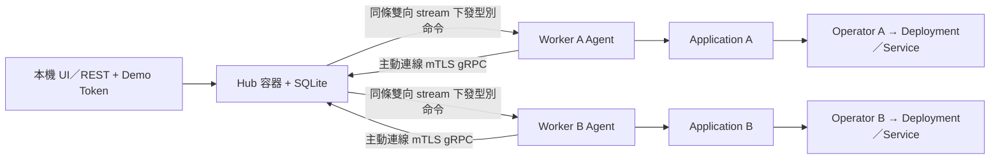

# M3：雙 kind、Agent 與 mTLS

本資料夾集中本階段的程式、YAML／JSON、Bash 與完整教學。找新增檔案與閱讀順序請看 [本階段的程式導讀](#本階段的程式導讀)。

本階段資源：[run.sh](run.sh)、[env.sh](env.sh)、[A 部署 JSON](deploy-a.json)、[B 部署 JSON](deploy-b.json)、[Agent 安裝 YAML](config/agent/install.yaml)、[啟動 Bash](scripts/control.sh)、[協定生成 Bash](scripts/proto.sh)、[驗收 Bash](scripts/e2e.sh)。在本資料夾可執行 `bash run.sh up`／`down`；**下方詳細練習的 make、source 與 curl 命令都以專案根目錄為起點**。

先看 [分階段學習](../README.md)。M3 是 M2 平台加上多叢集控制；Hub 操作介面與版本履歷相同，Kubernetes 寫入改由各 Worker Agent 執行。

Hub 保存部署意圖與履歷；Agent 在自己的 Worker 執行受限型別命令；Operator 持續維持工作負載。mTLS 驗證 Hub／Agent 的雙方身分，Demo Token 則驗證本機管理者的 HTTP 請求，兩者用途不同。

閱讀路線：[檔案地圖](#檔案地圖) → [啟動與登入](#啟動與登入) → [建立兩個應用](#建立應用後怎麼確認) → [真實 HTTP](#實際呼叫兩個-worker) → [離線／重連](#斷線修復與重連練習) → [故障與回滾](#故障版本與回滾練習) → [結束／再用](#結束再啟動與憑證輪替) → [診斷](#操作遇到問題時) → [程式導讀](#本階段的程式導讀)。

## 檔案地圖

| 位置 | 裡面做什麼 | 怎麼使用／修改 |
|---|---|---|
| [run.sh](run.sh) | 學習 state、Hub／雙 kind 入口 | up／down／hub-up／hub-stop／hub-recreate／agent-install／certs-dev |
| [env.sh](env.sh) | 終端選 Worker A 或 B 與隔離 kubeconfig | 使用 source；執行成另一個 Bash 程序不會改目前終端 |
| [deploy-a.json](deploy-a.json)／[deploy-b.json](deploy-b.json) | 兩個初次建立的 REST 請求 | 可改範例；同名不要再由 UI 重複建立 |
| [agent](agent/README.md) | Worker 的主動連線、命令執行、持久 ledger | 深入導讀與當地錯誤處理 |
| [agenttransport](agenttransport/README.md) | Hub 的 mTLS stream／session／命令派送 | 雖放在 M3，它實際在 Hub 程序執行 |
| [agentprotocol/projection.go](agentprotocol/projection.go) | CR spec／狀態與 wire 型別轉換、hash | Hub／Agent 共用，不自行再定義另一套配置 |
| [agenttls/tls.go](agenttls/tls.go)／[devcert/certs.go](devcert/certs.go) | TLS 驗證、cluster URI identity、Demo CA／leaf／Token 產生 | TLS 程式與本機開發憑證工具 |
| [api/proto](api/proto/) | 手寫 gRPC／Protobuf 契約 | 改協定從 control.proto 開始 |
| [api/agent/v1](api/agent/v1/) | 生成的 protobuf message／client／server Go | 不手改；由 make proto 生成 |
| [cmd/agent](cmd/agent/) | Worker Agent 程式入口 | 使用 Pod 的 ServiceAccount，組裝 Client／Engine |
| [cmd/certs-dev](cmd/certs-dev/)／[cmd/agentcheck](cmd/agentcheck/) | 憑證生成、等待已驗證 Agent 上線 | 由啟動流程呼叫；不拿 Host HTTP 取代通道驗證 |
| [cmd/proto-tool](cmd/proto-tool/)／[scripts/proto.sh](scripts/proto.sh) | 固定 compiler／generator 與協定生成 | 開發協定時使用 |
| [config/agent/install.yaml](config/agent/install.yaml) | Agent SA／Role／Binding、ledger、Deployment | 手寫模板；HUB_ENDPOINT／CLUSTER_ID 由啟動流程代換，不能原樣 apply |
| [build/agent.Dockerfile](build/agent.Dockerfile) | Worker Agent 映像 | 修改 Agent Go 後重建／載入／重啟 |
| [scripts/control.sh](scripts/control.sh) | 憑證、Hub mounts、雙 Worker、endpoint 解析、清理 | 想理解 up 看這裡；學習通常用 run／Make |
| [scripts/e2e.sh](scripts/e2e.sh)／[test/e2e](test/e2e/) | 真實雙 kind、權限、重送／重啟／GC 驗收 | 專用測試環境，測試範圍見階段驗收文件 |

M3 共用的 Hub 與 UI 仍在 [M2](../m2/hub/README.md)，Operator 在 [M1](../m1/controller/README.md)，價格服務在 [M0](../m0/pricing-api/README.md)。本頁最後列出 M3 修改的 M2 檔案。



## 啟動與登入

在 Ubuntu WSL2／Linux amd64，以非 root 開發使用者執行。先停止 M2 Hub，確保 18090 可用：

```bash
cd /mnt/c/Users/H/Documents/GitHub/win30221/hugofleet
make tools doctor
make m3-up
```

腳本建置真實映像，啟動 hugofleet-a／b、安裝兩份 Operator、啟動 Hub 容器、動態查 Hub Docker IP，再安裝使用 mTLS 的 Agents。不需要先執行 M2；M3 不掛載 Worker kubeconfig。

up 最後等待兩個經身分驗證的 Agent 連上，完成後返回命令列。首次下載／建置與兩個 kind 啟動可能較久；先讀終端進度與 artifacts/bootstrap-hugofleet-a／b 日誌。此時還沒有 pricing-a／pricing-b，建立應用是下一步。

### 終端配置與 state

| 終端 | 負責什麼 |
|---|---|
| A | 啟動、管理 Hub、查詢／控制某個 Worker |
| B | A 的服務轉送 18080，保持前景 |
| C | B 的服務轉送 18081，保持前景 |
| D | HTTP／REST 查詢；也可另開查詢用終端 |

每個新終端先 `cd /mnt/c/Users/H/Documents/GitHub/win30221/hugofleet`。預設 state 為 `.local/tutorials/m3`；自訂時，每個終端先 export 同一路徑，再 source env.sh。例如另開 A 查詢終端：

```bash
cd /mnt/c/Users/H/Documents/GitHub/win30221/hugofleet
# 僅自訂 session 時加：export HF_M3_STATE="$PWD/.local/tutorials/m3/session-02"
source stages/m3/env.sh a
kubectl --context kind-hugofleet-a -n hf-demo get deployments,pods
```

查 B 改成 `source stages/m3/env.sh b`，kubectl context 也改成 kind-hugofleet-b。source env.sh 會設定 HF_CLUSTER、HF_LEARNING_ROOT、KUBECONFIG 並切回專案根目錄。up 本身在子程序執行，不會替父終端完成這個設定。

### 啟動到底建立什麼

| 步驟 | 產物／原因 |
|---|---|
| 建四類映像 | pricing-api 三版、Operator、Hub、Agent |
| 雙 kind 建立與 image-load | A／B 各自有 Kubernetes API 與可用的本機業務映像 |
| 開發憑證與 Token | certs 下有 CA 公開憑證、Hub leaf、兩個 Worker leaf、隨機管理 Token |
| Hub 容器 | hugofleet-hub-m3 加入 kind network；HTTP 只 publish 到本機 18090 |
| 各 Worker Operator | 每個 Worker 自行依 Application 維持工作負載 |
| Agent endpoint 代換 | 動態讀 Hub Docker IP，產生 state 下的 agent-<cluster>.yaml |
| Agent 安裝 | hf-demo 的 SA／Role／Binding、TLS Secret、named ledger、Agent Deployment |
| 等上線 | 兩個 CONNECTED；Agent 主動建 mTLS gRPC stream，不要求 Hub 連 Worker API |

生成的 Agent YAML 在 state 裡，正式模板仍在 config。不要修改生成檔來保存配置，也不要把包含私鑰的 Secret 輸出當成一般教學範例。

如果之前使用 [M2 教學的舊單叢集開發入口](../m2/README.md#舊單叢集開發入口)，該 M2 叢集也叫 hugofleet-a。停止舊 Hub／轉送後，回原本 M2 終端執行 `make kind-down`，再建立 M3。新的 M2 教學叢集 hugofleet-m2-demo 有獨立名稱。

開啟 [本機管理登入](http://127.0.0.1:18090/login)。在自己的終端讀取本次 Token，貼入登入表單：

```bash
cat "${HF_M3_STATE:-$PWD/.local/tutorials/m3}/certs/admin-token"
```

不要把 Token／憑證貼到 issue、Git 或共享日誌。Token 檔與 DB 被 Git 忽略。登入 cookie 最多 8 小時；憑證有效 24 小時，Demo CA 48 小時，沒有自動輪替。管理 Token 是本機 Demo 防護，M4 才實作 OIDC／RBAC。

首頁兩個 Cluster 都應 CONNECTED，顯示 Agent 版本與最後心跳。建立 `pricing-a` 選 hugofleet-a、image pricing-api:v1，等待 SUCCEEDED／READY；再建立 `pricing-b` 選 hugofleet-b。同租戶名稱唯一，因此兩個應用使用不同名字。

## 建立應用後怎麼確認

M2 的表單欄位與版本規則仍適用。第一次建立兩邊都保持 port=8080、replicas=1、預設 resources 與 /readyz／/healthz。選 UI 或 REST 建立其中一條路徑即可，不要用另一條再 create 同名應用。

| 要看什麼 | 預期／含義 |
|---|---|
| 首頁 Cluster | hugofleet-a、hugofleet-b 都 CONNECTED，Agent 版本 m3 與最近聯絡時間 |
| Operation | CREATE 最終 SUCCEEDED；202／ACK 只是處理過程 |
| Application | READY，期望／已寫入／最後成功 revision 都為 1 |
| Worker A | pricing-a CR／Deployment／Service；pricing-a 的 Ready Pod |
| Worker B | pricing-b 對應資源；兩邊各有自己的 Operator／Agent |

例如查看 A 的物件：

```bash
source stages/m3/env.sh a
kubectl --context kind-hugofleet-a -n hf-demo get applications,deployments,services,pods
kubectl --context kind-hugofleet-a -n hf-demo get application pricing-a -o yaml
```

查 B 時換 env b、context b、名稱 pricing-b。平台同租戶名稱唯一，因此即使分到不同 cluster，仍用不同名稱。image tag 是程式建置版本，revision 是每個應用獨立的部署版本；A rev 2 不會推進 B revision。

## 實際呼叫兩個 Worker

終端 B 保持 A 轉送：

```bash
cd /mnt/c/Users/H/Documents/GitHub/win30221/hugofleet
source stages/m3/env.sh a
kubectl --context kind-hugofleet-a -n hf-demo port-forward --address 127.0.0.1 service/pricing-a 18080:8080
```

終端 C 保持 B 轉送：

```bash
cd /mnt/c/Users/H/Documents/GitHub/win30221/hugofleet
source stages/m3/env.sh b
kubectl --context kind-hugofleet-b -n hf-demo port-forward --address 127.0.0.1 service/pricing-b 18081:8080
```

終端 D：

```bash
for port in 18080 18081; do
  curl --fail "http://127.0.0.1:$port/version"
  curl --fail "http://127.0.0.1:$port/quote" \
    -H 'Content-Type: application/json' \
    --data '{"amount_cents":20000,"customer_tier":"vip","coupon_code":"SAVE100"}'
done
```

兩者價格結果都為 8000。更新 image／副本後，先等 rollout 與舊 Pod 退出，再重新建立 port-forward。

## 斷線、修復與重連練習

先由 UI 將 pricing-a 更新為 replicas=2 並等成功，再停止 A Agent：

```bash
source stages/m3/env.sh a
kubectl --context kind-hugofleet-a -n hf-demo scale deployment/hugofleet-agent --replicas=0
```

正常關閉會較快 DISCONNECTED；沒有 heartbeat 時約 15 秒逾時。重新整理首頁及應用詳細頁，A 應用顯示 UNKNOWN，保留最近觀測時間；B 仍可正常發布。新的 A 部署、更新、回滾與刪除會以 503 拒絕，不會默默入列。

此時由 UI 打開 pricing-b，發版成 pricing-api:v2-good、replicas=2，等 B 的 Operation SUCCEEDED／READY。停止 C 轉送、重新建立 B 轉送後，在 D 查 18081/version，應為 v2-good。這能確認 A 離線期間，B 的實際管理與服務流程仍在工作。

若 A 的原頁面仍 READY，先重新整理並等待 Runner 更新連線狀態；UNKNOWN 表示目前不能取得新觀測，不表示舊 Pod 已停止。連線時間、現況與歷史 Operation 要分開讀。

修改 A 底層 Deployment：

```bash
kubectl --context kind-hugofleet-a -n hf-demo scale deployment/pricing-a --replicas=1
kubectl --context kind-hugofleet-a -n hf-demo get deployment/pricing-a -w
```

Operator 不依賴 Agent／Hub，會把 replicas 修復為 2。Ctrl+C 結束 watch，恢復 Agent：

```bash
kubectl --context kind-hugofleet-a -n hf-demo scale deployment/hugofleet-agent --replicas=1
kubectl --context kind-hugofleet-a -n hf-demo rollout status deployment/hugofleet-agent --timeout=180s
```

A 重新握手、核對持久化 ledger 與實際 CR，再恢復 READY。ACK 不表示 rollout 成功；應以 Operation SUCCEEDED、CR 與 Deployment readiness 判斷。

停止／恢復 Agent 不會新增應用的 deployment revision。可在重連前後讀 Application 的 metadata.uid、generation、spec.revision；這個練習沒有發新意圖，因此不應因重連而另建一個同名 CR。Operator 修復 Deployment 也不需 Agent 在線。

## 故障版本與回滾練習

延續前面的主線，pricing-a 在 rev 2 已有兩個 v1 副本。先確認 A CONNECTED、前一操作已結束，再由 UI 發版為 pricing-api:v2-broken，其他配置保持不變：

1. 產生 A rev 3；等這次 Operation FAILED／TIMED_OUT，讀 error_code／message 與 CR conditions。
2. 在 A 詳細頁的回滾欄選已成功 rev 2，確認後提交；產生新 rev 4，還原 v1／兩副本的完整配置。
3. 等回滾 SUCCEEDED／READY，確認舊 Pod 退出，重建 B 終端的 **Worker A** 轉送，再呼叫 18080/version／quote。

| 步驟 | A desired／applied／last successful（CR 寫入已確認時） | B |
|---|---|---|
| 初始 v1 成功 | 1／1／1 | rev 1／v1 |
| A 增兩副本成功 | 2／2／2 | 仍 rev 1 |
| A 離線，B 發新版 | A revision 不變、現況 UNKNOWN | rev 2／v2-good 成功 |
| A 重連、壞版失敗 | 3／3／2 | 繼續 rev 2 |
| A 回滾成功 | 4／4／4，image 仍是 v1 | 不受 A 回滾影響 |

若你插入其他更新，使用畫面中的實際 revision。失敗操作之後即使目前變 Ready，也不會改寫原 Operation 終態；完整原因見 [M2 狀態與回滾](../m2/README.md#8-第五課releaseoperation目前狀態與回滾)。

刪除仍從 Hub UI 勾選確認、等待 DELETE SUCCEEDED／Application DELETED；Agent 用 CR UID 防止誤刪同名其他資源，Operator 的相依工作負載由 GC 清理。Operator／Agent Pod 繼續存在是正常的。名稱與歷史留在 Hub DB，日後重新 create 使用新名稱或新一輪 state。

## REST

API 延續 [M2 契約](../../docs/m2-api.md)，建立應用改帶 `cluster_id: hugofleet-a` 或 `hugofleet-b`，每次請求加 Authorization。Token 透過 curl stdin 設定，避免出現在 process arguments：

```bash
printf 'header = "Authorization: Bearer %s"\n' "$(cat "${HF_M3_STATE:-$PWD/.local/tutorials/m3}/certs/admin-token")" |
  curl --fail --config - http://127.0.0.1:18090/api/v1/clusters
```

其餘仍要求 Idempotency-Key／expected_desired_revision；不允許把既有應用遷移至另一叢集。

本階段範例為 `stages/m3/deploy-a.json`／`deploy-b.json`。尚未由 UI 建立同名應用時，可使用 A 範例；B 改用 deploy-b.json 與不同 Idempotency-Key：

```bash
printf 'header = "Authorization: Bearer %s"\n' "$(cat "${HF_M3_STATE:-$PWD/.local/tutorials/m3}/certs/admin-token")" |
  curl --fail-with-body --config - http://127.0.0.1:18090/api/v1/tenants/demo/apps \
    -H 'Content-Type: application/json' -H 'Idempotency-Key: m3-lesson-a-1' \
    --data-binary @stages/m3/deploy-a.json
```

回應 202 後以回傳的 operation_id 查詢，或在 UI 等到 SUCCEEDED／READY，再建立服務轉送。預設 DB、憑證、Token 與各 Worker kubeconfig 均在 `.local/tutorials/m3/`。

### 查詢與發版也要帶 Token

在同一個專案根目錄終端定義此本機函式，避免每次複製 credential 設定；它只存在於目前 Shell，沒有新增產品功能：

```bash
hf_m3_curl() {
  printf 'header = "Authorization: Bearer %s"\n' "$(cat "${HF_M3_STATE:-$PWD/.local/tutorials/m3}/certs/admin-token")" |
    curl --fail-with-body --config - "$@"
}
app_id='<A 回傳的 application_id>'
operation_id='<A 回傳的 operation_id>'
hf_m3_curl "http://127.0.0.1:18090/api/v1/operations/$operation_id"
hf_m3_curl "http://127.0.0.1:18090/api/v1/tenants/demo/apps/$app_id"
```

尚未建立 B 時用同函式 POST apps、不同 key 與 deploy-b.json。release 的內容不再帶 name／cluster_id，避免誤以為能重新命名或遷移：

```bash
# 僅對尚未更新的 A rev 1 使用；UI 已增副本就不要再照這份基準送。
hf_m3_curl "http://127.0.0.1:18090/api/v1/tenants/demo/apps/$app_id/releases" \
  -H 'Content-Type: application/json' -H 'Idempotency-Key: m3-lesson-a-replicas-2' \
  --data '{"expected_desired_revision":1,"image":"pricing-api:v1","replicas":2}'
```

抄下新 operation_id 再查直到終態。key、expected revision、完整快照、回滾與刪除的規則延續 [API 契約](../../docs/m2-api.md)；把範例 URL 換成實際 ID，使用此帶 Token 的函式。預期 409／503 時用 `if hf_m3_curl ...; then ...; else ...; fi` 觀察錯誤，避免嚴格 Shell 因 curl 非零直接結束。

## 結束、再啟動與憑證輪替

停止 port-forward 後：

```bash
make m3-hub-stop # 只停止 Hub；Worker Operator／服務繼續存在
make m3-hub-up   # 同一容器、DB、憑證再啟動，Agent 自動重連
```

完整結束用 `make m3-down`，只清理 exact ownership record 對應的 Hub 與兩個 kind，保留 DB／憑證。**重建 Worker 時需新 HF_M3_STATE**，不可把舊 UID 綁定 DB 直接用於新叢集。範例見 [分階段學習](../README.md)。`m3-hub-recreate` 僅重建 owned Hub 容器、保留 DB；之後 `make agent-install` 重新解析 Hub IP，讓 Agents 使用新 endpoint。

憑證到期後，結束本次 Demo，再指定新的專案 `.local/tutorials/m3/session-*` state 從頭建立；舊 DB 仍留在舊 state，這是新的練習，不代表原履歷已恢復。自動輪替、備份還原及保留既有 Worker／履歷的憑證更換流程尚未驗證，本教學不把它們列為已可用的步驟。

### 各命令會改什麼

| 命令 | 適用情況 | 效果與保留 |
|---|---|---|
| m3-up | 第一次組裝整課，或重準備同輪依賴 | 建置映像／準備雙 kind／安裝 Operator／Agent；不自動 create 業務應用 |
| m3-hub-stop | 暫停管理程序 | 停 owned Hub 容器；Worker、DB、憑證保留 |
| m3-hub-up | 恢復原管理程序 | 原容器存在時啟動同一容器，不自動換映像／policy |
| m3-hub-recreate | 同 Worker／DB，重建 Hub 容器 | 替換 owned Hub 容器；Docker IP 可能變，再 agent-install |
| agent-install | 更新 Agent endpoint／安裝配置 | 解析目前 Hub IP，對 A／B 載入既有 Agent 映像、安裝／重啟 |
| certs-dev | 同 state 尚無 CA 時準備憑證 | 已有 CA 時重用，不自動延長到期時間 |
| m3-down | 結束環境 | 限定清理 Hub／雙 kind，保留 state 檔案 |

M3 主程式／映像共用目前來源。只修改 Agent Go 後執行 agent-install 不會替你編新映像；先建置映像再載入／重啟。只改 policy.json 也不會變更原 Hub 容器裡的檔案。

### 同 Worker／DB 更新 Hub 程式或 policy

這是需要重新建置時的開發操作，執行測試範圍見階段驗收文件。保留同一 HF_M3_STATE，以專案根目錄操作：

```bash
source stages/m3/env.sh a
docker build --platform linux/amd64 -f stages/m2/build/hub.Dockerfile -t hugofleet-hub:m3 .
make m3-hub-recreate
make agent-install
```

重建後重新等兩個 CONNECTED，再操作。DB 仍屬於原兩個 Worker，這與重建 Worker 換新 state 是兩種情況。Agent 映像的 build 檔為 stages/m3/build/agent.Dockerfile；想理解編譯與映像的差別先看 [stages 索引](../README.md)。

### 完整關閉後從頭再練習

先停 B、C 的轉送，在原 state 終端執行 m3-down。再在專案根目錄：

```bash
export HF_M3_STATE="$PWD/.local/tutorials/m3/session-02"
make m3-up
```

其他終端也 export 相同路徑，再 source env.sh。這一輪使用新 Token、憑證、DB 與雙 Worker；舊 state 不刪除。session 只隔開執行資料，Hub／kind 名稱仍相同，所以不可讓兩輪同時運作。

state 的主要檔案：db/hub.db（含 WAL／鎖）、certs/（leaf／Token）、hub.id、agent-hugofleet-a.yaml／b.yaml、clusters/hugofleet-a／b/（kubeconfig／cluster.id／kind YAML）。Worker 私鑰由 bootstrap 用來建立 Secret；Hub 只掛 DB、CA、自己的 leaf cert／key、admin-token 共五個 mount，沒有 Worker 私鑰／kubeconfig／Docker socket。

## 驗證與診斷

下方自動驗收命令供開發選用，測試範圍見階段驗收文件，不需先跑全套才閱讀本課。

本階段理解檢查：

| 問題 | 用本階段操作核對 |
|---|---|
| Hub 如何操作沒有 kubeconfig 的 Worker？ | Worker Agent 主動建立受 mTLS 驗證的雙向通道 |
| Agent 離線後誰修復既有服務？ | Worker 內的 Operator 繼續 Reconcile |
| ACK 是否代表部署成功？ | ACK 確認命令處理；SUCCEEDED 還需實際 rollout readiness |
| 重連為何不能直接覆寫 CR？ | 先核對 UID、revision 與持久化 ledger，拒絕舊命令 |
| 為何晚到 Ready 不改寫逾時歷史？ | Operation 保存那次操作的結果；Application 表示目前觀測 |

本指南涵蓋 M3 的獨立操作。後續 M4／M5 已有獨立教學與既有本機驗收；目前修正與重驗進度以根 README 和驗證報告為準。

```bash
make operator-tools envtest proto-tools
make proto-check
make lint build docs-check test-unit verify-generated
make test-race test-integration
make test-e2e-m3
```

M3 E2E 自行建置、建立獨立 hugofleet-m3-e2e-a／b 與 Hub 容器；成功及失敗都收集日誌並做 owned cleanup。實測結果見 [M3 紀錄](../../docs/m3-validation.md)。

```bash
docker logs hugofleet-hub-m3 --tail=100
source stages/m3/env.sh a
kubectl --context kind-hugofleet-a -n hf-demo logs deployment/hugofleet-agent --tail=100
kubectl --context kind-hugofleet-a -n hf-demo logs deployment/hugofleet-operator --tail=100
docker stats --no-stream hugofleet-hub-m3 hugofleet-a-control-plane hugofleet-b-control-plane
```

若 Pod → Hub 連線失敗，先核對 Agent endpoint、Hub Docker IP、憑證 SAN／到期與本機 Docker 網路；不能只看 Host healthz 就宣稱雙叢集成功。固定設計與容量／持久性限制見 [ADR 0008](../../docs/adr/0008-m3-outbound-agent.md)。

## 操作遇到問題時

先分三段：HTTP 是否能管理 Hub → 指定 Agent 是否 CONNECTED → 指定 Worker 的 CR／workload 是否 Ready。Hub /healthz 正常只代表 HTTP 程序可回應，不代表雙 Worker 部署成功。

以下查 A；查 B 改 env、context 與 pricing-b。新終端先 cd 專案，自訂 session 先 export HF_M3_STATE：

```bash
cd /mnt/c/Users/H/Documents/GitHub/win30221/hugofleet
source stages/m3/env.sh a
docker logs hugofleet-hub-m3 --tail=100
kubectl --context kind-hugofleet-a -n hf-demo get applications,deployments,services,pods
kubectl --context kind-hugofleet-a -n hf-demo logs deployment/hugofleet-agent --tail=100
kubectl --context kind-hugofleet-a -n hf-demo logs deployment/hugofleet-operator --tail=100
kubectl --context kind-hugofleet-a -n hf-demo get events --sort-by=.lastTimestamp
```

查看 Agent 的非 secret 設定與 Hub 實際位址：

```bash
kubectl --context kind-hugofleet-a -n hf-demo get deployment hugofleet-agent \
  -o jsonpath='{.spec.template.spec.containers[0].args}'
docker inspect --format '{{(index .NetworkSettings.Networks "kind").IPAddress}}' hugofleet-hub-m3
```

撥號 endpoint 要對上目前 IP:18443；TLS 驗證仍使用 hub.hugofleet.local。不要把 endpoint IP 改成 localhost；在 Worker Pod 中 localhost 是該 Pod，不是 Hub。

| 現象 | 怎麼處理 |
|---|---|
| 18090 connection refused | 確認 Hub 容器存在／執行，是否上一課仍占 port；M2 與 M3 一次只開一個 |
| 403／unexpected Host | 用精確 127.0.0.1:18090，不改成 localhost；核對 Token／session 或 gateway 拒絕日誌 |
| UI 回到登入 | session 到期或這輪 Token 不同；用同 state 的 Token 登入 |
| TLS unknown CA／expiry／SAN | 核對目前 state 和憑證；不關閉 TLS 驗證，到期使用新 state 重建 |
| CONNECTED 一直沒有出現 | 查 Agent rollout／日誌、endpoint、Hub IP、憑證 identity 與 Hello；重建 Hub 後 agent-install |
| duplicate／draining session | 同 cluster 已有連線或舊命令未排空；等舊 session 收尾，不加第二個 Agent 副本搶身分 |
| A 離線、B 操作也看似失敗 | 分別讀 /api/v1/clusters 與 B 應用 Operation；全域 /readyz 不能代替 B 狀態 |
| CR 已提交但 Operation 未成功 | Applied／ACK 不等於 rollout；查 CR generation／conditions、Deployment／Pod |
| 更新後 /version 仍舊 | 等 rollout／舊 Pod 退出，重建該 Worker 的轉送 |
| OWNERSHIP_CONFLICT／STALE_REVISION | 查是否混用舊 DB、新 Worker、不同 state 或手改 CR；不刪 ledger 繞過保護 |
| LEDGER_FULL | 需要受控處理容量；本課不提供自動修剪 tombstone 的捷徑 |
| down ownership mismatch | 確認目前 state 與原 hub.id／cluster.id；不接管其他同名容器 |

如果在管理 API 看到 409，沿 [M2 衝突說明](../m2/README.md#9-第六課為什麼會遇到-409以及資源預檢做什麼) 查 key、基準 revision 與活動操作。離線新意圖回 503；故障 rollout 記錄在原 Operation，不要靠重送舊 key 偽裝新部署。

## 本階段的程式導讀

深入函式與錯誤處理看 [Agent](agent/README.md) 與 [Hub Transport](agenttransport/README.md)。前者在 Worker 執行，後者在 Hub 執行。

M3 新增 Worker Agent、受 mTLS 驗證的 gRPC 雙向通道與 Hub 遠端 Transport。沿用 M0 應用、M1 Operator、M2 Hub。Hub 不取得 Worker kubeconfig；Agent 主動連到 Hub，用當地受限 ServiceAccount 提交 Application。

| 閱讀順序 | 本階段新增的檔案 | 要理解的事情 |
|---|---|---|
| 1 | [control.proto](api/proto/hugofleet/agent/v1/control.proto) | Hello／heartbeat、apply／delete／snapshot、result 契約 |
| 2 | [agent/main.go](cmd/agent/main.go) | Worker 內啟動 Agent 與當地 Kubernetes client |
| 3 | [agent/client.go](agent/client.go) | 主動連線、心跳、單一 executor、斷線重連 |
| 4 | [agent/engine.go](agent/engine.go) | 受限命令、deadline、revision／UID／ledger／tombstone |
| 5 | [agenttransport/transport.go](agenttransport/transport.go) | Hub 接受 stream、registry、派送、snapshot 與重試 |
| 6 | [agenttls/tls.go](agenttls/tls.go)、[devcert/certs.go](devcert/certs.go) | CA／SAN／URI identity 驗證、Demo 憑證生成 |
| 7 | [agentprotocol/projection.go](agentprotocol/projection.go) | 共用 spec／result 轉換與雜湊契約 |
| 8 | [m3_test.go](test/e2e/m3_test.go) | 真實雙 kind、離線修復、重送、重啟、逾時與 GC |

[api/agent/v1](api/agent/v1) 是 proto 產物，用 `make proto` 生成；[proto-tool](cmd/proto-tool/main.go) 驗證並解壓 compiler；[certs-dev](cmd/certs-dev/main.go) 產生本機 Demo 憑證；[agentcheck](cmd/agentcheck/main.go) 等待兩個已驗證 Agent 上線。[config/agent/install.yaml](config/agent/install.yaml) 放 Agent 安裝／最小權限／named ledger 設定；[build/agent.Dockerfile](build/agent.Dockerfile) 打包 Worker 程式。

M3 同時修改以下 **M2 共用程式**，所以在 m2 資料夾找得到目前的 Hub：

| 共用檔案 | M3 增加的行為 |
|---|---|
| [cmd/hub/main.go](../m2/cmd/hub/main.go) | `--mode=m3`、mTLS listener、registry、Token；此分支不建立 kube client |
| [hub/domain/model.go](../m2/hub/domain/model.go) | 叢集連線與 Agent 版本資料 |
| [hub/service/service.go](../m2/hub/service/service.go) | 各叢集獨立進度、原 deadline、晚到 Ready 保留終態 |
| [repository/clusters.go](../m2/hub/repository/clusters.go)、[003_agent.sql](../m2/hub/repository/003_agent.sql) | M3 registry／agent version、模式隔離與 migration |
| [httpapi/auth.go](../m2/hub/httpapi/auth.go)、[server.go](../m2/hub/httpapi/server.go) | Token／session、gateway／Host／Origin／CSRF 檢查 |
| [UI template](../m2/web/templates/index.html) | A／B 選擇、Agent 聯絡時間／狀態／錯誤 |

單階段開發可用 make m3-build／m3-test；協定修改才需要 make proto-tools／proto 重新生成，再用 proto-check 核對。這些與首次 up 是不同用途，完整驗收入口見上方「驗證與診斷」，測試範圍與證據見 [驗證總覽](../../docs/validation.md)。

Hub 的映像建置檔仍在 [M2 build/hub.Dockerfile](../m2/build/hub.Dockerfile)；本資料夾的 [scripts/control.sh](scripts/control.sh) 組裝 Hub／雙 Worker；教學入口 [run.sh](run.sh) 選用本階段 runtime 目錄。讀完應能說明 Hub 與 Worker 的權限邊界、ACK 與 Ready 的差別、重送為何不覆蓋新版本。後續獨立操作見 [M4](../m4/README.md) 與 [M5](../m5/README.md)，先用本階段的原 state 執行 down 再切換。
