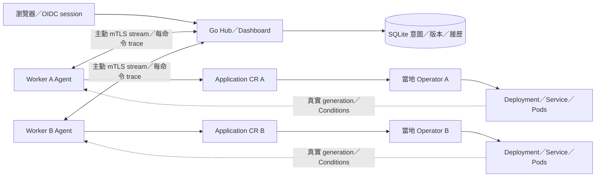

# M5：Dashboard、可觀測部署與安全交付

目前位置：M5／M0～M5 學習路線 · [上一課 M4](../m4/README.md#完成這一課後去哪裡) · [選課與回訪](../README.md#回來繼續哪一課)

第一次練習從[開始前的準備](#開始前的準備)進入；上次做到一半則先看[回來繼續時先選擇](#回來繼續時先選擇)。

## 這一課的目標與成果

這一課會帶你在 Dashboard 完成部署、故障與回滾，查看跨元件 trace／metrics，再理解 Helm 如何安裝 Worker 元件。登入與租戶角色沿用 M4，M5 入口自行準備整課環境。

| 操作順序 | 在哪裡 | 看到什麼才繼續 |
|---|---|---|
| 啟動 M5 | 終端 A | 顯示雙 Worker 連線，命令返回 |
| admin 登入、啟用租戶 | 瀏覽器 | A／B profile 啟用成功 |
| owner-a 建立 pricing-api | 瀏覽器 | SUCCEEDED／READY |
| 轉送並呼叫 | 終端 B／C | v1、價格 8000 |
| 更新、漂移、故障與回滾 | 瀏覽器／終端 A | 修復兩副本，回滾成功 |
| 查看指標與追蹤 | 瀏覽器 admin | 讀取實際 metrics／spans |
| 結束 | 停轉送後 make m5-down | owned 環境移除，私有 state 保留 |

先完成操作，後面的程式導讀、Helm／telemetry 深入文件與自動驗收可按需要閱讀。預期結果供你核對，既有證據見 [M5 驗收](../../docs/m5-validation.md)。

完成後，你會看到 Dashboard 與真實服務狀態一致、故障回滾留下履歷，以及實際 metrics／spans。Hub viewer 只顯示 Hub spans，跨元件 trace 需另收集日誌。

依序閱讀：[開始前的準備](#開始前的準備) → [逐步操作](#逐步操作) → [整課驗證與常見問題](#整課驗證與常見問題) → [停止與下次繼續](#停止與下次繼續)。完成後再查[原理與進階閱讀](#原理與進階閱讀)。

## 開始前的準備

### 從主目錄開始

Windows 從專案資料夾開 PowerShell，執行 `wsl -d Ubuntu`。後續 Bash 命令都在專案根目錄，以非 root 的 Linux 使用者執行；細節見[根 README](../../README.md#首次準備環境)。未安裝工具才執行 `make tools`，已完成前面課程者直接檢查環境並準備 Helm：

```bash
make doctor
make helm-tools
```

Helm 4.3.0 只安裝到專案 .tools，使用官方 archive SHA-256。Go、Kubernetes、CNI／Dex 沿用固定版本；M5 不要求常駐 Collector、Grafana 或額外監控叢集。

### 終端分工

| 終端／介面 | 用途 |
|---|---|
| A | 啟動、查詢 Worker、漂移練習與結束 |
| B | 價格 API 轉送，保持執行 |
| C | curl 呼叫 |
| 瀏覽器 | admin 啟用租戶、Owner 部署、查看 Dashboard |

新終端從同一個專案資料夾開 PowerShell，再執行 `wsl -d Ubuntu`。自訂 HF_M5_STATE 時，各終端沿用相同設定。

## 逐步操作

依下列順序切換終端與瀏覽器。每一步先核對預期結果再繼續；命令失敗時，先看[常見問題](#操作遇到問題時)，不要接著執行後續變更。

### 終端 A：啟動

先以原階段的原 state 執行 down。M3／M4／M5 教學預設共用 hugofleet-a／hugofleet-b 名稱；不能切換 state 後接管原容器。無關 lab 保留。

```bash
make m5-up
```

此入口會準備雙 Worker、登入服務、Dashboard 與 Helm 元件。完成後應返回命令列，且顯示兩個 Worker 已連線；此時尚未授予租戶角色或部署應用。

控制畫面為 http://127.0.0.1:18095/login，Dex 使用 host port 5557；Docker 內部 Dex port 仍為 5556。憑證、DB、accounts、subjects、values 與精確 Container ID 記錄位於 .local/tutorials/m5，受到 Git 忽略。自訂練習目錄時，在首次 up 前 export HF_M5_STATE；後續每個新終端的 source env.sh、status、hub-stop／up／recreate 與 down 都沿用同一路徑。

首次冷啟動可能等待數十分鐘，包含映像建置、CNI 預載與兩個 Worker 的建立。請等目前啟動結束，避免同時執行 race 等重型編譯；Node／CNI／CoreDNS 與工作負載都會檢查 readiness。失敗時先讀 bootstrap 日誌與下方診斷。

**下一步：**確認本步結果後，前往[管理員：啟用租戶](#管理員啟用租戶)。 若未符合預期，先到[操作排查](#操作遇到問題時)，處理後回到本步重試。

### 管理員：啟用租戶

1. 在本地編輯器開啟 `.local/tutorials/m5/accounts.json`（自訂 state 使用該資料夾），找到 admin 的 email／password，於 `http://127.0.0.1:18095/login` 完成 Dex 登入。帳號資料僅保留在本機，不貼入共享日誌。
2. 到「租戶與成員」。啟用 team-a／Team A，選 A，Owner 選 accounts.json 中 owner-a 對應的已登錄 email／User ID。
3. 同樣啟用 team-b／Team B，Owner 為 owner-b。
4. 依相同 slug、名稱與 Owner 再啟用 B，加入第二個已 provision 的 Worker profile。

平台向 Agent 核對實際 namespace／receipt／Quota／LimitRange；email 僅作顯示，身分綁定 issuer + sub。啟用不修改 Worker 安全政策。最後一位 Owner 不能移除，OIDC groups 不會授予平台角色。

**下一步：**確認本步結果後，前往[Owner：部署與查看](#owner部署與查看)。 若未符合預期，先到[操作排查](#操作遇到問題時)，處理後回到本步重試。

### Owner：部署與查看

登出並以 owner-a 登入，選 Team A，展開「建立應用」。使用 pricing-api、A、pricing-api:v1 及預設資源提交；先看到 QUEUED／DEPLOYING。待真實 rollout 完成才顯示 SUCCEEDED／READY。

Overview 顯示完整授權範圍的 counts 與最多 20 筆操作；Applications 每頁最多 50 筆，可按 Tenant／Cluster 篩選。詳情保留 desired／applied／last successful revision、真實 CR generation／Conditions、最後觀測、完整配置與有界履歷。Viewer 不顯示變更表單，直接越權請求仍由後端拒絕。

提交後的 pending 詳情為唯讀狀態頁，每五秒更新、最多 30 次；可編輯表單與確認頁不自動刷新。達上限後可手動更新，或返回可編輯詳情。

**下一步：**確認本步結果後，前往[終端 B：轉送，終端 C：呼叫服務](#終端-b轉送終端-c呼叫服務)。 若未符合預期，先到[操作排查](#操作遇到問題時)，處理後回到本步重試。

### 終端 B：轉送，終端 C：呼叫服務

```bash
make m5-forward-a
```

命令選 Worker A，預設 team-a 的 pricing-api 與本機 18080，不必先 export 或 source。自訂資料目錄時，每個終端仍使用同一份 `HF_M5_STATE`。

<details>
<summary>展開：底層指令與環境設定</summary>

若直接使用 kubectl，先在同一終端執行 `source stages/m5/env.sh a`，操作 B 時改用 `b`；自訂 state 先設定同一路徑。短命令會自行載入環境。

```bash
source stages/m5/env.sh a
export HF_TENANT=team-a HF_APP=pricing-api
make m5-forward
```

</details>

等待 B 顯示 `Forwarding`，保持執行。轉送只建立本機測試連線，不會建立 Ingress。終端 C 呼叫：

```bash
curl --fail --silent http://127.0.0.1:18080/version
curl --fail --silent --show-error http://127.0.0.1:18080/quote \
  -H 'Content-Type: application/json' \
  -d '{"amount_cents":20000,"customer_tier":"vip","coupon_code":"SAVE100"}'
```

預期最終價格為 8000 分。Ctrl+C 停止這個 port-forward；不刪除工作負載。本課主線固定呼叫 Worker A。發版／回滾替換 Pod 時，既有 port-forward 可能因原 Pod 結束而退出；等 rollout 完成後重新執行 `make m5-forward-a`，再驗證新版本。若要轉送 B 或其他應用，使用下方進階環境設定及原有 `make m5-forward`。

**下一步：**確認本步結果後，前往[故障、修復與回滾](#故障修復與回滾)。 若未符合預期，先到[操作排查](#操作遇到問題時)，處理後回到本步重試。

### 故障、修復與回滾

#### 第一步：發布健康版，再觀察漂移修復

Owner 在詳情發布 pricing-api:v2-good／replicas 2，等 SUCCEEDED／READY。終端 A 明確選 Worker A，再製造漂移：

```bash
make m5-drift
make m5-observe
```

這兩個命令選 Worker A，預設操作 team-a 的 pricing-api。Application 保持 2，故意把 Deployment 改為 1，再持續觀察 Operator 修回 2。最後 READY 應為 `2/2`；修復太快可能看不到中間的 1。按 Ctrl+C 停止觀察。

<details>
<summary>展開：底層指令與環境設定</summary>

若直接使用 kubectl，先在同一終端執行 `source stages/m5/env.sh a`，操作 B 時改用 `b`；自訂 state 先設定同一路徑。短命令會自行載入環境。

```bash
source stages/m5/env.sh a
kubectl --kubeconfig "$KUBECONFIG" --context "kind-$CLUSTER" \
  -n hf-team-a scale deployment/pricing-api --replicas=1
kubectl --kubeconfig "$KUBECONFIG" --context "kind-$CLUSTER" \
  -n hf-team-a rollout status deployment/pricing-api --timeout=180s
```

</details>

再次核對 Worker A 的配置與實際 Pod：

```bash
make m5-workload-status
```

Application 與 Deployment 都應要求兩個副本，價格 API READY 為 `2/2`。漂移修復不新增發版 revision。

<details>
<summary>展開：底層指令與環境設定</summary>

若直接使用 kubectl，先在同一終端執行 `source stages/m5/env.sh a`，操作 B 時改用 `b`；自訂 state 先設定同一路徑。短命令會自行載入環境。

Operator 應恢復 2。再執行以下命令，確認 Deployment 的 spec.replicas 與 READY 副本數都為 2：

```bash
kubectl --kubeconfig "$KUBECONFIG" --context "kind-$CLUSTER" \
  -n hf-team-a get deployment pricing-api
kubectl --kubeconfig "$KUBECONFIG" --context "kind-$CLUSTER" \
  -n hf-team-a get deployment pricing-api -o jsonpath='{.spec.replicas}{"\n"}'
```

</details>

Dashboard Conditions 反映真實結果。rollout status 只等待部署狀態，逾時不會停止控制器；請讀 events 後再繼續。

#### 第二步：發布故障版，再回滾

1. 在應用詳情發布 `pricing-api:v2-broken`，保留兩副本與其他配置。
2. 等 Operation FAILED／TIMED_OUT，讀錯誤原因與真實 Conditions；上一個成功版本與 request_id 保留。
3. 按回滾，選剛才成功的 v2-good 快照並確認。
4. 等新 revision SUCCEEDED／READY，確認舊 Pod 退出。
5. 停止並重建 B 的 Worker A 轉送，在 C 查版本與價格，應為 v2-good、8000 分。

回滾新增 revision，不覆寫失敗履歷。

#### 第三步：觀察 Worker B 離線與恢復

在終端 A 選擇 Worker B，暫停受限 Agent，觀察 Dashboard 的 DISCONNECTED 與最後心跳；當地 Operator 持續工作。若 B 尚未建立應用，此步只驗證 Agent 連線，不代表已測試 B 的業務服務。所有演練只操作這個 owned Worker，完成後恢復 replicas 1。

```bash
make m5-agent-stop-b
```

這個命令固定停止 Worker B 的 Agent，不會停止 A 或既有服務。先回 Dashboard 確認 B 顯示 DISCONNECTED，再執行恢復。

<details>
<summary>展開：底層指令與環境設定</summary>

若直接使用 kubectl，先在同一終端執行 `source stages/m5/env.sh a`，操作 B 時改用 `b`；自訂 state 先設定同一路徑。短命令會自行載入環境。

```bash
source stages/m5/env.sh b
kubectl --kubeconfig "$KUBECONFIG" --context "kind-$CLUSTER" \
  -n hf-system scale deployment/hugofleet-agent --replicas=0
```

</details>

先回 Dashboard 重新整理，等待 B 顯示 DISCONNECTED 並核對最後心跳。預設心跳逾時為 15 秒；若仍 CONNECTED，先確認 Agent 已縮為零並查看日誌，不要立刻恢復。

確認離線結果後，再於同一終端恢復：

```bash
make m5-agent-start-b
```

命令等待 B Agent Pod 就緒；回 Dashboard 等 B 顯示 CONNECTED，才能確認控制通道已恢復。

<details>
<summary>展開：底層指令與環境設定</summary>

若直接使用 kubectl，先在同一終端執行 `source stages/m5/env.sh a`，操作 B 時改用 `b`；自訂 state 先設定同一路徑。短命令會自行載入環境。

```bash
kubectl --kubeconfig "$KUBECONFIG" --context "kind-$CLUSTER" \
  -n hf-system scale deployment/hugofleet-agent --replicas=1
kubectl --kubeconfig "$KUBECONFIG" --context "kind-$CLUSTER" \
  -n hf-system rollout status deployment/hugofleet-agent --timeout=180s
```

</details>

Agent rollout 完成後，再回 Dashboard 等 B 顯示 CONNECTED；Pod 就緒本身不代表控制通道已連上。

**下一步：**確認本步結果後，前往[瀏覽器 admin：看一次部署的指標與追蹤](#瀏覽器-admin看一次部署的指標與追蹤)。 若未符合預期，先到[操作排查](#操作遇到問題時)，處理後回到本步重試。

### 瀏覽器 admin：看一次部署的指標與追蹤

1. 保留本輪 Hub，登出 owner-a，再用本輪 admin 帳號登入。
2. 從 Dashboard 開啟 `/metrics`。可看到 operations 次數、耗時與 Agent 連線等指標；它們是目前程序生命期的數值，Hub 重啟會歸零。
3. 開啟 `/traces`，查看這個 Hub 程序保留的 spans，以 operation／request 關聯查找剛才的操作。
4. 若要看同一次操作跨 Hub、Agent、Operator 的完整關聯，依[觀測教學](observability/README.md)收集三者日誌，再產生離線 HTML；Hub viewer 本身不會自動收齊 Worker 日誌。

Owner／Viewer 不具有全域 telemetry 權限。操作歷史仍以 SQLite 為準，metrics 不能取代持久履歷。

**下一步：**前往[整課驗證](#整課驗證與常見問題)，核對這一輪的結果。 若未符合預期，先到[操作排查](#操作遇到問題時)，處理後回到本步重試。

## 整課驗證與常見問題

完成主線後，核對以下結果；若有一項未達成，先排查再繼續。

- Dashboard 的成功狀態對應實際 API，價格回傳 8000。
- 漂移修復為兩副本，壞版回滾恢復 v2-good 並保留失敗履歷。
- B Agent 停止後顯示 DISCONNECTED，恢復後顯示 CONNECTED。
- Admin 可查看 metrics／Hub spans；跨元件完整 trace 另依觀測文件收集。

這些是本輪操作的檢查點，不是新的驗收證據。自動化測試與既有結果見 [M5 驗收](../../docs/m5-validation.md)。


**核對完成後：**若已達成本課成果，前往[停止與下次繼續](#停止與下次繼續)。想繼續進階實作時先保留環境，從[原理與進階閱讀](#原理與進階閱讀)選擇練習；純閱讀不需保持服務運作。尚有問題則先用下方排查，修正後回到失敗步驟。
### 操作遇到問題時

| 現象 | 下一步 |
|---|---|
| 登入後沒有 Team A | admin 先啟用真實 Worker profile，指定正確 Owner |
| 頁面不再自動更新 | pending 頁每五秒、最多 30 次，達上限後手動更新 |
| metrics／traces 回 403 | 換 admin 登入，Owner 不具全域權限 |
| 更新後 API 還是舊版 | 等完整 rollout 與舊 Pod 退出，再重建轉送 |
| Agent 斷線 | 查 status、Agent 日誌與憑證；UNKNOWN 不代表 Pod 停止 |
| Helm ownership 衝突 | 核對原 state 的 values／receipt／release，不接管外來資源 |

在專案根目錄的查詢終端操作，自訂 state 時沿用同一路徑：

先確認管理平台與應用兩層狀態：

```bash
make m5-status
make m5-workload-status
```

第一個查 Hub／Dex／Agent，第二個查 Worker A 預設 team-a 的 pricing-api、期望副本與事件。查不到應用時，先回 Dashboard 看建立操作；需要日誌時再展開。

<details>
<summary>展開：詳細狀態與日誌指令</summary>

```bash
source stages/m5/env.sh a
kubectl --context kind-hugofleet-a -n hf-system logs deployment/hugofleet-agent --tail=100
kubectl --context kind-hugofleet-a -n hf-team-a get applications,deployments,pods
kubectl --context kind-hugofleet-a -n hf-team-a get events --sort-by=.lastTimestamp
```

</details>

## 停止與下次繼續

### 回來繼續時先選擇

先依原環境的情況選一條路；下方停止與重建命令不是需要依序全部執行的清單。

| 目前情況 | 下一步 |
|---|---|
| 原 Worker 正常，只停了轉送 | 先核對同輪 Hub 與 Agent 狀態，再重新建立轉送，回[逐步操作](#逐步操作)接續。 |
| 只執行 hub-stop，Worker 與憑證仍有效 | 使用原 state 的 `make m5-hub-up`，等待 Agent CONNECTED，再繼續操作。 |
| 已 down、Worker 重建或憑證失效 | 依下方重建說明先處理原環境，再選新 state開始新一輪；保留舊資料不等於能恢復舊 Worker。 |
| 不確定上次停在哪裡 | 沿用原 state，先看[操作排查](#操作遇到問題時)，不要直接換資料目錄。 |

### 重啟、檢查與結束

依目的選一個操作，不必依序全部執行。使用原 state：

| 目的 | 命令 | 預期結果 |
|---|---|---|
| 查看環境 | `make m5-status` | 顯示 Hub／Dex、Worker Node 與 Agent Deployment |
| 暫停管理 | `make m5-hub-stop` | Hub 停止，Worker 繼續執行 |
| 恢復管理 | `make m5-hub-up` | 原 Hub 啟動，Agent 重連 |
| 更新 Hub 容器 | `make m5-hub-recreate` | 原 DB 保留，更新 Agent endpoint |
| 結束整課 | `make m5-down` | 移除 owned Hub／Dex／Workers，保留私有資料 |

第一次結束只需在 B 按 Ctrl+C，再於 A 執行 `make m5-down`。若要單獨刪除應用，先在 Hub 中由 Owner 確認刪除並等 DELETED，再關閉環境。

hub-stop／up 保留原容器、DB／歷史。hub-recreate 保留 DB，重新解析 Hub IP 並以 Helm 更新 Agent；ledger／receipt 不重設。down 只移除這次 state 所擁有的 Hub／Dex／Workers，保留私有資料。

**kind Worker 被移除後，當地 CR UID／ledger／etcd 不會由 Hub DB 還原。** 要再練全新 Demo，保留舊 state 並選新資料夾：

```bash
export HF_M5_STATE="$PWD/.local/tutorials/m5/practice-02"
make m5-up
```

不要將舊 DB 綁到重建 Worker 假裝繼續原部署；UID／receipt 衝突會拒絕，履歷仍保留。

### 完成這一課後去哪裡

- **完成整條學習路線：**先停止轉送，以原 state 執行 `make m5-down`。回到[選課與回訪](../README.md#回來繼續哪一課)重練指定階段；需要檢查程式時，再看[驗證總覽](../../docs/validation.md)。
- **下次繼續／重新練習：**回到[本輪環境選擇](#回來繼續時先選擇)，依原叢集與資料是否仍有效決定恢復方式。
- **深入本課：**閱讀[原理與進階閱讀](#原理與進階閱讀)。要做需要叢集的進階演練，先保留本輪環境；完整 down 後須依重建流程重新準備。

## 原理與進階閱讀

以下依需要查閱；進階演練若需要仍在執行的環境，請在完整 down 前操作。開發測試入口不屬於首次教學的必做步驟。

### 啟動流程與元件

入口順序為固定 images → A（Calico）→ B（kindnet）→ pricing images → Dex 真實 subjects → Hub → bootstrap 安全材料 → Helm install／upgrade → 真實 rollout → receipt → 六個真實 Hub 登入／登出。角色與 Tenant 尚未授予，不能直接宣稱應用已部署。

### 架構與狀態來源



Hub 沒有 Worker kubeconfig。獨立的主機 bootstrap／Helm 使用本地管理員 kubeconfig 準備安全材料與受限元件；瀏覽器與 Agent 不提供任意 YAML／shell／exec 功能。Worker 是 readiness 的權威，SQLite 保存意圖與不可變歷史。

### 程式導讀

| 位置 | 用途 |
|---|---|
| [run.sh](run.sh)、[env.sh](env.sh)、[control.sh](scripts/control.sh) | 正式 Make／階段入口、owned state、Docker／kind／Helm lifecycle |
| [Hub](cmd/hub/main.go)、[共用 startup](../m4/hubapp/run.go) | 啟用 Dashboard／telemetry，保留 M4 OIDC／session／角色與五個隔離 mounts |
| [HTML／CSS](web/)、[共用 HTTP API](../m4/httpapi/README.md) | Overview、Clusters、篩選、Conditions、確認表單、最多 30 次狀態更新 |
| [Observability](observability/README.md) | 每命令 OTel parent／channel correlation、安全 JSON spans、四項有限 labels 的 metrics |
| [Helm Chart](chart/README.md) | CRD／受限 Operator／Agent／RBAC；不接管或刪除安全資料 |
| [共用 Store](../m2/hub/repository/)、[projection](../m3/agentprotocol/) | schema 5：trace context 與最後觀測；完整 generation／Conditions／transition time |
| [Helm 驗證](test/chart/) | 真正 Helm CLI、typed manifest／negative schema checks，使用 helmintegration tag |

M5 沒有複製另一套 Hub 業務邏輯。M4 入口預設不開 M5 telemetry／頁面；各階段使用同一份目前版本的 module。

管理 API 契約見 [M5 OpenAPI](../../docs/openapi-m5.yaml)，共用角色與 mutation 規則引用 M4，最新觀測／trace 欄位引用共用模型。

### 重建、憑證與 E2E 中斷恢復補充

hub-recreate 只更新 Hub endpoint，沿用 Helm release 的 values／rollout，不重新 bootstrap 租戶 quota／receipt／ledger，並將最新 values 保存回原 state。完整 up／workers 是重新套用教學預設值的入口，不能當成自訂配額後的 Hub 恢復指令。HF_M5_HEARTBEAT_TIMEOUT 控制 Hub 心跳逾時（預設 15s，3s～5m），需 hub-recreate 套用。

開發 mTLS leaf 有效 24 小時、CA 48 小時；up／hub-recreate 不會續期。過期後新的握手會失敗，可從 Hub／Agent 日誌確認 certificate expired。重新練習時，先以原 state 執行 down，再指定尚不存在的新 HF_M5_STATE 啟動；原 DB／帳號／憑證保留。原地輪替且保留歷史的流程尚未驗收，不要直接刪除 certs 或 DB。

E2E 中斷後，必須指定原執行日誌的 state 和全部名稱。先把下方 `原執行編號` 換成該次實際目錄名稱，核對其中 hub.id／dex.id／clusters 的 ownership；不能只設定 state、原樣使用佔位路徑或刪除記錄繞過 ownership：

```bash
export HF_M5_STATE="$PWD/.local/m5-e2e-原執行編號"
HF_M5_A=hugofleet-m5-e2e-a HF_M5_B=hugofleet-m5-e2e-b \
HF_M5_HUB=hugofleet-hub-m5-e2e HF_M5_DEX=hugofleet-dex-m5-e2e \
bash stages/m5/run.sh down
```

跨階段 OIDC 負向測試使用 `make test-oidc`；需釋放 M4 測試埠 5556／18094／18444，約 15 分鐘的真實 JWT 自然到期也包含在內，詳見 [M4 測試](../m4/README.md#測試與證據)。

### 本機檢查

```bash
make operator-tools proto-tools
make m5-build m5-test
make helm-tools m5-chart-test
make lint docs-check proto-check verify-generated
```

上方 operator-tools／proto-tools 安裝固定版本的生成器，供 verify-generated／proto-check 使用。首次執行 envtest／race 再準備 envtest binaries。先結束目前 Demo，再依序執行，避免讓 race 編譯和 kind 冷啟動競爭本機資源：

```bash
make envtest
make test-unit test-race
make test-e2e-m5
```

test-e2e-m5 使用新的 .local/m5-e2e-* state、專用 hugofleet-m5-e2e-a／b Workers 與 Hub／Dex；若同名資源已存在會拒絕接管，須先用其原 state 的正式 down 清理。入口自行建置映像、完成兩個 Worker／Helm／真實 Dex 登入，依序跑完整 M4 安全套件及 M5 Dashboard／trace／Helm lifecycle，最後收集診斷並清理 owned 容器。原始結果在 artifacts/m5-e2e，私有 state 保留；啟動、測試或清理失敗都回傳非零，不能只看其中一個 PASS。

Unit／race／envtest、M5 kind 入口與 Helm lifecycle 的驗收範圍見 [M5 驗收](../../docs/m5-validation.md)；對應程式提交的 Hosted CI 證據見 [驗證總覽](../../docs/validation.md)。[Demo 播放頁](../../docs/media/m5-demo.html) 與 [MP4](../../docs/media/m5-demo.mp4) 使用真實瀏覽器操作截圖按順序剪輯，並非連續錄影；等待片段已省略。影片展示部署、漂移修復、壞版、確認回滾、Worker 斷線／恢復、跨租戶與 metrics 拒絕；[來源 metadata 與 SHA-256](../../docs/media/m5-demo-captures.json) 可供核對。[實際回滾 trace](../../docs/media/m5-rollback-trace.html) 由 Hub／Agent／Operator 已收集 JSON spans 產生。

### 限制

單 Hub／SQLite、手動憑證管理、loopback Dex 帳號及開發 kind 都不是生產 HA。只有 A 的 Calico 有實際 NetworkPolicy enforcement；B 的 Policy 為 configuration only。Metrics 為程序生命期數值，Hub 重啟歸零；持久 operation history 以 SQLite 為準。頁面顯示配額宣告，沒有冒充即時使用量。

**讀完深入內容後：**回到[本課完成後的選擇](#完成這一課後去哪裡)，接續下一課、重新練習或結束環境。
