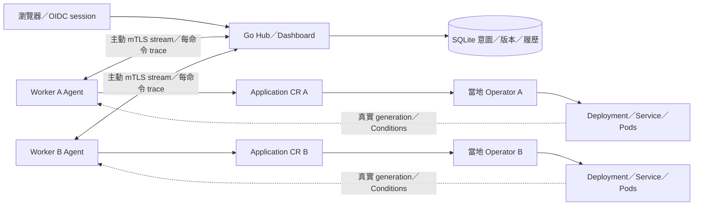

# M5：Dashboard、可觀測部署與安全交付

本階段整合安全 Hub、雙 Worker 與 Helm，提供應用狀態、跨程序追蹤、指標與交付流程。驗收範圍見 [M5 驗收](../../docs/m5-validation.md)，設計見 [ADR 0011](../../docs/adr/0011-observability-and-delivery.md)。

測試方式與對應程式提交的 Hosted CI 證據見 [驗證總覽](../../docs/validation.md)。

## 從主目錄開始

先讀 [根 README](../../README.md)、[階段索引](../README.md) 及 [M4 登入與角色](../m4/README.md)。所有 Bash 命令於 Linux amd64／Ubuntu WSL2、以非 root 的 Linux 使用者執行：

```bash
cd /mnt/c/Users/H/Documents/GitHub/win30221/hugofleet
make tools doctor
make helm-tools
```

Helm 4.3.0 只安裝到專案 .tools，使用官方 archive SHA-256。Go、Kubernetes、CNI／Dex 沿用固定版本；M5 不要求常駐 Collector、Grafana 或額外監控叢集。

## 程式導讀

| 位置 | 用途 |
|---|---|
| [run.sh](run.sh)、[env.sh](env.sh)、[control.sh](scripts/control.sh) | 正式 Make／階段入口、owned state、Docker／kind／Helm lifecycle |
| [Hub](cmd/hub/main.go)、[共用 startup](../m4/hubapp/run.go) | 啟用 Dashboard／telemetry，保留 M4 OIDC／session／角色與五個隔離 mounts |
| [HTML／CSS](web/)、[共用 HTTP API](../m4/httpapi/README.md) | Overview、Clusters、篩選、Conditions、確認表單、最多 30 次狀態更新 |
| [Observability](observability/README.md) | 每命令 OTel parent／channel correlation、安全 JSON spans、四項有限 labels 的 metrics |
| [Helm Chart](chart/README.md) | CRD／受限 Operator／Agent／RBAC；不接管或刪除安全資料 |
| [共用 Store](../m2/hub/repository/)、[projection](../m3/agentprotocol/) | schema 5：trace context 與最後觀測；完整 generation／Conditions／transition time |
| [Helm 驗證](test/chart/) | 真正 Helm CLI、typed manifest／negative schema checks，使用 helmintegration tag |

M5 沒有複製另一套 Hub 業務邏輯。M4 入口預設不開 M5 telemetry／頁面；各階段使用同一份目前版本的 module。

管理 API 契約見 [M5 OpenAPI](../../docs/openapi-m5.yaml)，共用角色與 mutation 規則引用 M4，最新觀測／trace 欄位引用共用模型。

## 架構與狀態來源



Hub 沒有 Worker kubeconfig。獨立的主機 bootstrap／Helm 使用本地管理員 kubeconfig 準備安全材料與受限元件；瀏覽器與 Agent 不提供任意 YAML／shell／exec 功能。Worker 是 readiness 的權威，SQLite 保存意圖與不可變歷史。

## 終端 A：啟動

先以原階段的原 state 執行 down。M3／M4／M5 教學預設共用 hugofleet-a／hugofleet-b 名稱；不能切換 state 後接管原容器。無關 lab 保留。

```bash
bash stages/m5/run.sh up
# 等價於 make m5-up
```

入口順序為固定 images → A（Calico）→ B（kindnet）→ pricing images → Dex 真實 subjects → Hub → bootstrap 安全材料 → Helm install／upgrade → 真實 rollout → receipt → 六個真實 Hub 登入／登出。角色與 Tenant 尚未授予，不能直接宣稱應用已部署。

控制畫面為 http://127.0.0.1:18095/login，Dex 使用 host port 5557；Docker 內部 Dex port 仍為 5556。憑證、DB、accounts、subjects、values 與精確 Container ID 記錄位於 .local/tutorials/m5，受到 Git 忽略。自訂練習目錄時，在首次 up 前 export HF_M5_STATE；後續每個新終端的 source env.sh、status、hub-stop／up／recreate 與 down 都沿用同一路徑。

首次冷啟動可能等待數十分鐘。這台 WSL／Docker 環境已實際遇過 containerd metadata flush 與 CNI 預載等待；bootstrap 時先完成重型 build／race，再順序建立 Workers。不要更改執行中的 Bash 檔案。Node／CNI／CoreDNS 與每個 workload 都有實際 readiness 檢查，失敗不列 PASS。

## 管理員：啟用租戶

1. 由私有 accounts.json 找到 admin，完成真實 OIDC 登入。
2. 到「租戶與成員」。啟用 team-a／Team A，選 A，Owner 選 accounts.json 中 owner-a 對應的已登錄 email／User ID。
3. 同樣啟用 team-b／Team B，Owner 為 owner-b。
4. 依相同 slug、名稱與 Owner 再啟用 B，加入第二個已 provision 的 Worker profile。

平台向 Agent 核對實際 namespace／receipt／Quota／LimitRange；email 僅作顯示，身分綁定 issuer + sub。啟用不修改 Worker 安全政策。最後一位 Owner 不能移除，OIDC groups 不會授予平台角色。

## Owner：部署與查看

登出並以 owner-a 登入，選 Team A，展開「建立應用」。使用 pricing-api、A、pricing-api:v1 及預設資源提交；先看到 QUEUED／DEPLOYING。待真實 rollout 完成才顯示 SUCCEEDED／READY。

Overview 顯示完整授權範圍的 counts 與最多 20 筆操作；Applications 每頁最多 50 筆，可按 Tenant／Cluster 篩選。詳情保留 desired／applied／last successful revision、真實 CR generation／Conditions、最後觀測、完整配置與有界履歷。Viewer 不顯示變更表單，直接越權請求仍由後端拒絕。

提交後的 pending 詳情為唯讀狀態頁，每五秒更新、最多 30 次；可編輯表單與確認頁不自動刷新。達上限後可手動更新，或返回可編輯詳情。

## 終端 B：真實服務

```bash
cd /mnt/c/Users/H/Documents/GitHub/win30221/hugofleet
source stages/m5/env.sh a
export HF_TENANT=team-a HF_APP=pricing-api
make m5-forward
```

終端 C 呼叫實際 Service：

```bash
curl --fail --silent http://127.0.0.1:18080/version
curl --fail --silent --show-error http://127.0.0.1:18080/quote \
  -H 'Content-Type: application/json' \
  -d '{"amount_cents":20000,"customer_tier":"vip","coupon_code":"SAVE100"}'
```

預期最終價格為 8000 分。Ctrl+C 停止這個 port-forward；不刪除工作負載。B 的應用改用 source stages/m5/env.sh b，並指定自己租戶與應用。發版／回滾替換 Pod 時，既有 port-forward 可能因原 Pod 結束而退出；等 rollout 完成後重新執行 make m5-forward，再驗證新版本。

## 故障、修復與回滾

Owner 在詳情發佈 pricing-api:v2-good／replicas 2。主機管理員於已載入該 owned Worker 環境的終端製造漂移：

```bash
kubectl --kubeconfig "$KUBECONFIG" --context "kind-$CLUSTER" \
  -n hf-team-a scale deployment/pricing-api --replicas=1
kubectl --kubeconfig "$KUBECONFIG" --context "kind-$CLUSTER" \
  -n hf-team-a rollout status deployment/pricing-api --timeout=180s
```

Operator 應恢復 2，Dashboard Conditions 反映真實結果。再發佈 v2-broken，等待真實 ProgressDeadlineExceeded／FAILED；上一個成功版本與 operation request_id 保留。按回滾、選成功來源並確認，會產生新的 revision，不覆寫失敗履歷。

可於 B 暫停受限 Agent，觀察 DISCONNECTED、最後心跳與保留的 workload；當地 Operator 持續工作。所有演練只操作這個 owned Worker，完成後恢復 replicas 1。

```bash
source stages/m5/env.sh b
kubectl --kubeconfig "$KUBECONFIG" --context "kind-$CLUSTER" \
  -n hf-system scale deployment/hugofleet-agent --replicas=0
# 觀察後恢復：
kubectl --kubeconfig "$KUBECONFIG" --context "kind-$CLUSTER" \
  -n hf-system scale deployment/hugofleet-agent --replicas=1
kubectl --kubeconfig "$KUBECONFIG" --context "kind-$CLUSTER" \
  -n hf-system rollout status deployment/hugofleet-agent --timeout=180s
```

## 重啟、檢查與結束

```bash
make m5-status
make m5-hub-stop
make m5-hub-up
make m5-hub-recreate
make m5-down
```

hub-stop／up 保留原容器、DB／歷史。hub-recreate 保留 DB，重新解析 Hub IP 並以 Helm 更新 Agent；ledger／receipt 不重設。down 只移除這次 state 所擁有的 Hub／Dex／Workers，保留私有資料。

**kind Worker 被移除後，當地 CR UID／ledger／etcd 不會由 Hub DB 還原。** 要再練全新 Demo，保留舊 state 並選新資料夾：

```bash
export HF_M5_STATE="$PWD/.local/tutorials/m5/practice-02"
bash stages/m5/run.sh up
```

不要將舊 DB 綁到重建 Worker 假裝繼續原部署；UID／receipt 衝突會拒絕，履歷仍保留。

## 本機檢查

```bash
make operator-tools proto-tools
make m5-build m5-test
make helm-tools m5-chart-test
make lint docs-check proto-check verify-generated
```

上方 operator-tools／proto-tools 安裝固定版本的生成器，供 verify-generated／proto-check 使用。首次執行 envtest／race 再準備 envtest binaries。先結束目前 Demo，再依序執行，避免讓 race 編譯和 kind 冷啟動競爭本機資源：

```bash
make envtest
make test-unit test-race
make test-e2e-m5
```

test-e2e-m5 使用新的 .local/m5-e2e-* state、專用 hugofleet-m5-e2e-a／b Workers 與 Hub／Dex；若同名資源已存在會拒絕接管，須先用其原 state 的正式 down 清理。入口自行建置映像、完成兩個 Worker／Helm／真實 Dex 登入，依序跑完整 M4 安全套件及 M5 Dashboard／trace／Helm lifecycle，最後收集診斷並清理 owned 容器。原始結果在 artifacts/m5-e2e，私有 state 保留；啟動、測試或清理失敗都回傳非零，不能只看其中一個 PASS。

Unit／race／envtest、M5 kind 入口與 Helm lifecycle 的驗收範圍見 [M5 驗收](../../docs/m5-validation.md)；對應程式提交的 Hosted CI 證據見 [驗證總覽](../../docs/validation.md)。[Demo 播放頁](../../docs/media/m5-demo.html) 與 [MP4](../../docs/media/m5-demo.mp4) 使用真實瀏覽器操作截圖按順序剪輯，並非連續錄影；等待片段已省略。影片展示部署、漂移修復、壞版、確認回滾、Worker 斷線／恢復、跨租戶與 metrics 拒絕；[來源 metadata 與 SHA-256](../../docs/media/m5-demo-captures.json) 可供核對。[實際回滾 trace](../../docs/media/m5-rollback-trace.html) 由 Hub／Agent／Operator 已收集 JSON spans 產生。

## 限制

單 Hub／SQLite、手動憑證管理、loopback Dex 帳號及開發 kind 都不是生產 HA。只有 A 的 Calico 有實際 NetworkPolicy enforcement；B 的 Policy 為 configuration only。Metrics 為程序生命期數值，Hub 重啟歸零；持久 operation history 以 SQLite 為準。頁面顯示配額宣告，沒有冒充即時使用量。

## 重建、憑證與 E2E 中斷恢復補充

hub-recreate 只更新 Hub endpoint，沿用 Helm release 的 values／rollout，不重新 bootstrap 租戶 quota／receipt／ledger，並將最新 values 保存回原 state。完整 up／workers 是重新套用教學預設值的入口，不能當成自訂配額後的 Hub 恢復指令。HF_M5_HEARTBEAT_TIMEOUT 控制 Hub 心跳逾時（預設 15s，3s～5m），需 hub-recreate 套用。

開發 mTLS leaf 有效 24 小時、CA 48 小時；up／hub-recreate 不會續期。過期後新的握手會失敗，可從 Hub／Agent 日誌確認 certificate expired。重新練習時，先以原 state 執行 down，再指定尚不存在的新 HF_M5_STATE 啟動；原 DB／帳號／憑證保留。原地輪替且保留歷史的流程尚未驗收，不要直接刪除 certs 或 DB。

E2E 中斷後，必須指定原執行日誌的 state 和全部名稱。先把下方 `原執行編號` 換成該次實際目錄名稱，核對其中 hub.id／dex.id／clusters 的 ownership；不能只設定 state、原樣使用佔位路徑或刪除記錄繞過 ownership：

```bash
export HF_M5_STATE="$PWD/.local/m5-e2e-原執行編號"
HF_M5_A=hugofleet-m5-e2e-a HF_M5_B=hugofleet-m5-e2e-b \
HF_M5_HUB=hugofleet-hub-m5-e2e HF_M5_DEX=hugofleet-dex-m5-e2e \
bash stages/m5/run.sh down
```

跨階段 OIDC 負向測試使用 `make test-oidc`；需釋放 M4 測試埠 5556／18094／18444，約 15 分鐘的真實 JWT 自然到期也包含在內，詳見 [M4 測試](../m4/README.md#測試與證據)。
